# ICONLITE Workshop 2026
## From Sample to Species: Amplicon Sequencing Using Oxford Nanopore Technology
### Companion Laboratory and Bioinformatics Handbook

**Native Barcoding Kit 24 V14 (`SQK-NBD114.24`) · PromethION · EPI2ME `wf-16s`**  
**Version:** 1.0 (draft) · 8 November 2026  

> [!WARNING]
> **Educational companion.** The current Oxford Nanopore Technologies protocol remains the controlling reference for any actual laboratory work. For research use only.

---

## Table of Contents

- [About This Handbook](#about-this-handbook)
  - [How to Use This Handbook](#how-to-use-this-handbook)
  - [Learning Objectives](#learning-objectives)
- [Part A – Scientific Foundations](#part-a--scientific-foundations)
  - [Chapter 1. Introduction and Core Biological Questions](#chapter-1-introduction-and-core-biological-questions)
  - [Chapter 2. Scientific Rationale](#chapter-2-scientific-rationale)
  - [Chapter 3. Sequencing Strategies](#chapter-3-sequencing-strategies)
  - [Chapter 4. Marker Selection and Primer Design](#chapter-4-marker-selection-and-primer-design)
    - [4.1 Bacterial and Archaeal Ribosomal Markers (16S rRNA and 16S–23S Operon)](#41-bacterial-and-archaeal-ribosomal-markers-16s-rrna-and-16s23s-operon)
    - [4.2 Fungal Ribosomal Markers (ITS1, 5.8S, ITS2, and 28S)](#42-fungal-ribosomal-markers-its1-58s-its2-and-28s)
    - [4.3 Eukaryotic and Microeukaryotic Markers (18S rRNA)](#43-eukaryotic-and-microeukaryotic-markers-18s-rrna)
    - [4.4 Animal and Metazoan Markers (Mitochondrial COI)](#44-animal-and-metazoan-markers-mitochondrial-coi)
    - [4.5 Vertebrate and Fish eDNA Markers (Mitochondrial 12S rRNA)](#45-vertebrate-and-fish-edna-markers-mitochondrial-12s-rrna)
    - [4.6 Plant Metabarcoding Markers (Chloroplast trnL)](#46-plant-metabarcoding-markers-chloroplast-trnl)
  - [Chapter 5. Sequencing Platform Selection](#chapter-5-sequencing-platform-selection)
  - [Chapter 6. Nanopore Sequencing Principles and Basecalling](#chapter-6-nanopore-sequencing-principles-and-basecalling)
    - [6.1 Biophysical Mechanism of Nanopore Sensing](#61-biophysical-mechanism-of-nanopore-sensing)
    - [6.2 Pore Architecture: Evolution from R9.4.1 to R10.4.1 Dual Reader Heads](#62-pore-architecture-evolution-from-r941-to-r1041-dual-reader-heads)
    - [6.3 Neural Network Basecalling: Decoding Raw Ionic Currents into Nucleotides](#63-neural-network-basecalling-decoding-raw-ionic-currents-into-nucleotides)
  - [Chapter 7. ONT Instrumentation and Experimental Planning](#chapter-7-ont-instrumentation-and-experimental-planning)
- [Part B – ONT Laboratory Workflow](#part-b--ont-laboratory-workflow)
  - [Chapter 8. Laboratory Workflow Overview](#chapter-8-laboratory-workflow-overview)
  - [Chapter 9. Native Barcoding Kit V14 Guided Practical](#chapter-9-native-barcoding-kit-v14-guided-practical)
    - [9.1 Preparing and Evaluating PCR Amplicons](#91-preparing-and-evaluating-pcr-amplicons)
    - [9.2 End-Preparation: Preparing DNA for Ligation](#92-end-preparation-preparing-dna-for-ligation)
    - [9.3 Native Barcode Ligation and Sample Multiplexing](#93-native-barcode-ligation-and-sample-multiplexing)
    - [9.4 Sequencing Adapter Ligation and Final Library Clean-up](#94-sequencing-adapter-ligation-and-final-library-clean-up)
    - [9.5 Priming and Loading the PromethION Flow Cell](#95-priming-and-loading-the-promethion-flow-cell)
    - [9.6 MinKNOW Run Configuration and Data Generation](#96-minknow-run-configuration-and-data-generation)
    - [9.7 From FASTQ to Biological Interpretation (`wf-16s` Walkthrough)](#97-from-fastq-to-biological-interpretation-wf-16s-walkthrough)
- [Part C – Bioinformatics](#part-c--bioinformatics)
  - [Chapter 10. Nanopore Data Formats and Basecalling](#chapter-10-nanopore-data-formats-and-basecalling)
  - [Chapter 11. Quality Control and Taxonomic Assignment](#chapter-11-quality-control-and-taxonomic-assignment)
  - [Chapter 12. Community Visualization and Interpretation](#chapter-12-community-visualization-and-interpretation)
- [Part D – Critical Evaluation and Synthesis](#part-d--critical-evaluation-and-synthesis)
  - [Chapter 13. Limitations and Troubleshooting](#chapter-13-limitations-and-troubleshooting)
  - [Chapter 14. Summary, Synthesis and Further Reading](#chapter-14-summary-synthesis-and-further-reading)
- [Appendices](#appendices)
  - [Appendix A. Reagent and Consumables Checklist](#appendix-a-reagent-and-consumables-checklist)
  - [Appendix B. Barcode Assignment and Sample-Tracking Template](#appendix-b-barcode-assignment-and-sample-tracking-template)
  - [Appendix C. DNA Mass-to-Molarity Calculation Worksheet](#appendix-c-dna-mass-to-molarity-calculation-worksheet)
  - [Appendix D. Library Preparation Workflow Checklist](#appendix-d-library-preparation-workflow-checklist)
  - [Appendix E. Flow Cell Loading Checklist](#appendix-e-flow-cell-loading-checklist)
  - [Appendix F. FASTQ and Taxonomic Result Interpretation Guide](#appendix-f-fastq-and-taxonomic-result-interpretation-guide)
  - [Appendix G. Glossary](#appendix-g-glossary)
  - [Appendix H. References and Software/Version Register](#appendix-h-references-and-softwareversion-register)

---

## About This Handbook

This handbook is designed as a practical learning resource and reference guide for long-read amplicon sequencing using Oxford Nanopore Technologies (ONT). It explains the underlying scientific and biophysical mechanisms, detailed laboratory protocols, stoichiometric calculations, quality-control checkpoints, bioinformatic workflows, and ecological data interpretation.

### How to Use This Handbook

* Procedural steps and parameters are cross-referenced with official protocol specifications and established molecular literature.
* Crucial warnings highlight failure modes where errors (such as detergent/ethanol carryover or air bubbles) cause irreversible pore loss or library failure.
* Core biological questions structure each stage of experimental design and analysis: **Who is there? What might they be doing? Why is it necessary to know them?**

#### Table 1. Source-status tags used throughout
| Tag | Meaning |
|---|---|
| **`[MFR]`** | Procedure or value stated in the manufacturer protocol (ONT `SQK-NBD114.24`, PromethION, rev. NBA_9168_v114_revU_15Jul2026) or in EPI2ME `wf-16s` documentation |
| **`[ADAPT]`** | A reasonable adaptation not stated by the manufacturer; confirm before relying on it |
| **`[EX]`** | Conceptual or hypothetical worked example; not experimental data |
| **`[LAB]`** | Laboratory-specific practice that depends on equipment, workflow preferences, and local optimization |

### Learning Objectives

1. Distinguish DNA barcoding, metabarcoding, and shotgun metagenomics across experimental aims.
2. Select appropriate molecular markers and primer systems suited to specific taxonomic groups and fragment preservation states.
3. Understand the biophysical principles of nanopore sensing, R10.4.1 dual-reader head pore geometry, and neural network basecalling.
4. Master each operational phase of PCR amplicon verification, end-repair/dA-tailing, native barcode ligation, multiplex pooling, adapter attachment, and PromethION flow cell loading.
5. Trace the computational lifecycle of sequencing data from raw ionic currents (POD5) through basecalling, quality filtering, demultiplexing, and taxonomic assignment.
6. Critically evaluate community composition plots, diversity metrics, and potential artifacts arising from PCR bias, copy number variation, contamination, and reference database limitations.

---

## Part A – Scientific Foundations

### Chapter 1. Introduction and Core Biological Questions

A natural or clinical sample contains DNA from every biological entity present in or shed into that environment. Amplicon sequencing selects a phylogenetically informative marker gene, amplifies it through targeted PCR, sequences the amplified copies, and matches each read against curated reference databases.

Rather than treating sequencing as a black-box instrument run, rigorous experimental design addresses three fundamental ecological questions at every stage of the workflow:

1. **Who is there?**  
   Which organisms, lineages, taxa, or strains constitute the biological community? Amplicon sequencing provides a culture-independent census of community membership, detecting rare, unculturable, fastidious, or cryptic organisms that traditional visual or plating methods overlook.

2. **What might they be doing?**  
   What ecological roles, physiological capacities, or functional guilds do these taxa represent? While amplicon markers sequence phylogenetic labels rather than metabolic gene suites, high-resolution taxonomic identification (especially at genus and species rank) allows researchers to link detected community members to well-characterized metabolic traits—such as nitrogen fixation, sulfate reduction, organic matter decomposition, secondary metabolite biosynthesis, or pathogenicity.

3. **Why is it necessary to know them?**  
   Why does understanding community composition matter for environmental monitoring, industry, or public health? Characterizing microbial and macrobial assemblages reveals ecological health, bioindicators of pollution or recovery, shifts triggered by climate stress or anthropogenic disturbance, infectious outbreak dynamics, aquaculture pathogen reservoirs, and invasive species encroachment.

> [!TIP]
> Think of a molecular marker as a diagnostic barcode sequence naturally carried by every organism. PCR photocopies these barcodes millions of times, the nanopore reader decodes each single molecule in real time, and bioinformatics software classifies the resulting sequence against reference libraries to reveal community structure.

> [!NOTE]
> Every physical and bioinformatic stage functions as a selective filter: cell lysis and DNA extraction recovery, primer annealing efficiency, PCR cycle kinetics, bead cleanup size retention, adapter ligation efficiency, flow cell translocation speed, neural network basecaller calibration, read quality thresholds, and reference database currency. The final taxonomic table reflects the combined product of all these factors; results must always be interpreted critically in light of experimental controls.

---

### Chapter 2. Scientific Rationale

Traditional culture-based microbiology identifies only those organisms capable of growing on chosen synthetic media under specific incubation temperatures, oxygen tensions, and nutrient balances. In natural soil, freshwater, marine, and host-associated microbiomes, fewer than 1% of microbial species are readily culturable in isolation ("the great plate count anomaly"). Similarly, morphological identification of mixed larval, insect, or fungal samples requires rare taxonomic expertise and frequently fails for cryptic life stages or degraded specimens.

Targeted amplicon sequencing overcomes these bottlenecks by bypassing organism cultivation altogether. It recovers DNA directly from complex matrices, scales to multiplex dozens of samples simultaneously, and provides high sensitivity for low-abundance taxa.

#### Table 2. What each approach can and cannot tell you
| Approach | Answers | Misses |
|---|---|---|
| **Culture-based Plating** | What grows under given conditions; yields viable isolates for physiology and antibiotic susceptibility assays | Unculturable, fastidious, slow-growing, or dormant organisms; introduces strong medium-dependent bias |
| **Targeted Molecular ID (Isolates)** | Precise species confirmation for a single isolated specimen or colony | Cannot profile mixed communities in a single reaction; blind to taxa outside primer binding sites |
| **Amplicon Metabarcoding** | High-throughput community composition across mixed environmental or clinical samples | Does not prove cell viability or metabolic activity; relative sequence abundance does not strictly equal cell count |

> [!NOTE]
> Culture reports only organisms capable of growing under specific laboratory conditions and media, whereas amplicon sequencing recovers marker sequences amplified directly from sample DNA regardless of culturability. The two approaches are complementary and often combined in modern microbiology.

---

### Chapter 3. Sequencing Strategies

#### Table 3. Three related molecular strategies
| Feature | DNA Barcoding | DNA Metabarcoding | Shotgun Metagenomics |
|---|---|---|---|
| **Primary Question** | What is the species identity of this isolated organism? | Who is present across this complex, mixed biological community? | Who is present, and what full metabolic and functional gene repertoire do they carry? |
| **Sample Input** | DNA extracted from a single specimen, tissue punch, or pure culture | Mixed environmental DNA (eDNA), soil, stool, water, biofilm, or tissue blend | Total metagenomic DNA extracted directly from mixed environmental or host samples |
| **Target DNA** | Single targeted marker amplicon (e.g. full-length 16S, COI, or ITS) | Targeted PCR amplicons generated from mixed templates using universal primers | Untargeted, whole-genome shearing and sequencing of all recoverable DNA fragments |
| **Major Strengths** | Highly cost-effective; clean Sanger or long-read consensus; clear taxonomic resolution | Multiplexes dozens to hundreds of samples; highly sensitive to rare taxa at modest sequencing depth | Captures viruses, plasmids, novel lineages lacking primer sites, and complete functional metabolic pathways |
| **Key Limitations** | Restricted to one isolated specimen per reaction; fails on mixed community mixtures | Subject to primer binding bias, PCR chimera formation, and marker-length resolution limits | Substantially higher sequencing cost; host DNA often dominates reads; computationally demanding assembly |

A practical rule of thumb:
* To identify a single organism, pure isolate, or morphological specimen: **DNA barcoding**.
* To census community membership, monitor biodiversity shifts, or compare hundreds of water, soil, or gut samples: **DNA metabarcoding**.
* To discover novel enzymes, assess antimicrobial resistance gene suites, or reconstruct uncultured metagenome-assembled genomes (MAGs): **Shotgun metagenomics**.

---

### Chapter 4. Marker Selection and Primer Design

Selecting the proper molecular marker dictates the taxonomic breadth and phylogenetic resolution of an amplicon study. An ideal marker gene features two indispensable attributes:
1. **Highly conserved flanking regions** where universal PCR primers can bind across broad taxonomic domains without mismatched dropout.
2. **Internal hypervariable regions** that accumulate sufficient nucleotide divergence to discriminate distinct species or genera.

#### Table 4. Common amplicon markers across domains
| Marker | Target Domain | Typical Amplicon Length | Taxonomic Utility and Caveats |
|---|---|---|---|
| **16S rRNA** | Bacteria, Archaea | Variable regions (300–450 bp) or full-length (~1,500 bp) | Standard bacterial census; nine variable regions (V1–V9); gene copy number varies between 1 and >15 per genome |
| **16S–23S Operon (rRNA)** | Bacteria | ~4,500 bp (spans 16S, ITS spacer, 23S) | Unlocks high-confidence species- and strain-level resolution using long reads; requires high-molecular-weight DNA |
| **ITS1 / ITS2 / Full ITS** | Fungi | Variable (300–800 bp) or full operon (~2.5 kb) | Primary fungal barcode; multi-copy; high length variability induces PCR size bias; challenging global sequence alignment |
| **18S rRNA** | Eukaryotes, Protists | Short variable domains or full-length (~1,800 bp) | Broad eukaryotic surveillance; hypervariable V4 and V9 regions resolve major clades; limited species resolution in some groups |
| **Mitochondrial COI** | Animals, Invertebrates | Standard Folmer (~658 bp) or Leray mini-barcode (~313 bp) | Standard animal barcode; high interspecific divergence; primer mismatches common in non-model marine invertebrates |
| **Mitochondrial 12S rRNA** | Vertebrates, Fishes | Short fragments (~163–185 bp, e.g. MiFish) | Gold standard for aquatic vertebrate eDNA; recovers degraded DNA; short length limits discrimination of sister species |
| **Chloroplast trnL (UAA)** | Plants | P6 loop (~10–143 bp) or c/d intron (~400–600 bp) | Plant metabarcoding and ancient DNA; P6 loop amplifies exceptionally well in degraded herbivore diet and soil samples |

---

#### 4.1 Bacterial and Archaeal Ribosomal Markers (16S rRNA and 16S–23S Operon)

The 16S rRNA gene (~1,542 bp in *E. coli*) consists of nine hypervariable regions (V1 through V9) interspersed between conserved structural stems. Traditional short-read platforms typically sequence isolated sub-regions, such as V3–V4 (primers 341F / 805R, ~464 bp) or V4 (primers 515F / 806R, ~291 bp). While these short segments profile family- and genus-level community dynamics, they frequently lack sufficient nucleotide divergence to differentiate closely related pathogenic and commensal species (e.g. distinguishing *Bacillus anthracis* from *Bacillus cereus*, or *Escherichia coli* from *Shigella* species).

Nanopore sequencing enables full-length 16S sequencing (~1.5 kb) using classical primers 27F (`AGAGTTTGATCMTGGCTCAG`) and 1492R (`GGTTACCTTGTTACGACTT`). By capturing all nine variable regions in individual continuous reads, long-read sequencing significantly refines taxonomic classification to species rank.

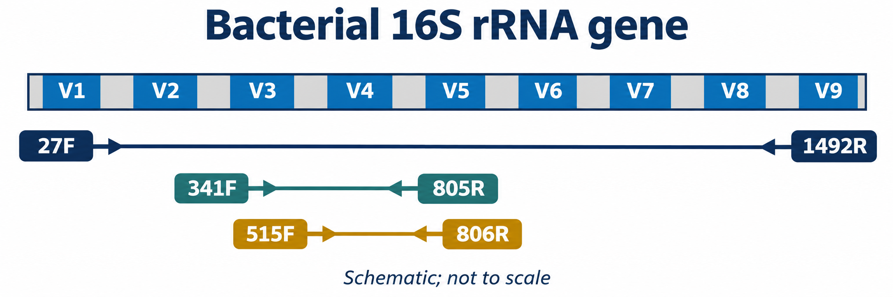  
*Figure 4.1. Organization of the bacterial 16S rRNA gene showing hypervariable regions V1–V9 and typical primer binding sites for full-length (27F/1492R) and short-read amplicons (341F/805R and 515F/806R).*

Where even full-length 16S fails to separate closely related strains, nanopore sequencing can target the entire bacterial ribosomal operon (~4.5 kb), amplifying continuously from the 5′ end of 16S, across the internal transcribed spacer (ITS) containing tRNA genes, and through the 23S rRNA gene using primers 27F and 23SR.

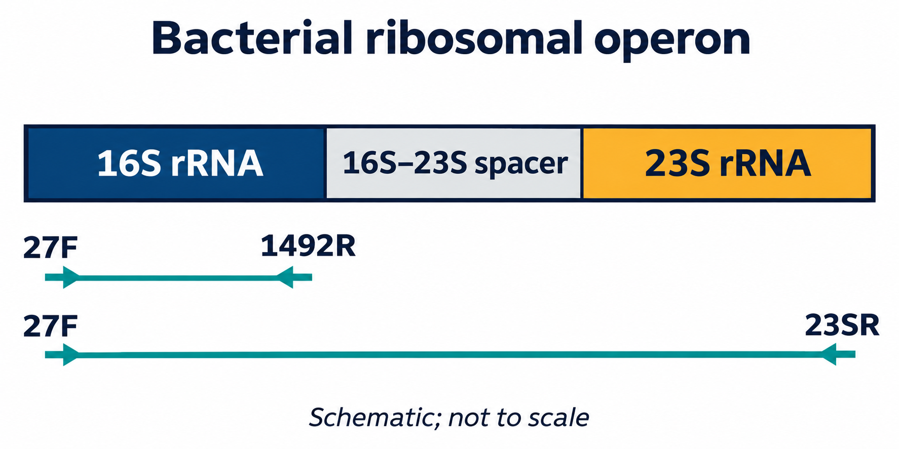  
*Figure 4.2. Schematic of the full bacterial ribosomal RNA operon (16S–ITS–23S) showing the extended target spanned by long-read amplicons for strain-level discrimination.*

---

#### 4.2 Fungal Ribosomal Markers (ITS1, 5.8S, ITS2, and 28S)

The fungal nuclear ribosomal internal transcribed spacer (ITS) region is the formal universal barcode for Fungi (Schoch et al. 2012). The locus consists of the highly variable ITS1 and ITS2 spacers separated by the conserved 5.8S rRNA gene, flanked upstream by the 18S (SSU) gene and downstream by the 28S (LSU) gene.

Common sub-regional primers include:
* **ITS1F / ITS2:** Targets ITS1 alone (~300 bp).
* **ITS3 / ITS4:** Targets ITS2 alone (~350 bp).
* **ITS1F / ITS4:** Spans the complete ITS region (ITS1–5.8S–ITS2, ~600–800 bp).

Because fungal ITS spacers exhibit pronounced natural insertion/deletion length polymorphisms across taxonomic classes, short-read sequencing often suffers from severe amplification length bias (shorter fragments amplify exponentially faster than longer ones). Long-read nanopore sequencing easily accommodates length-variable amplicons and can extend across the adjacent D1/D2 hypervariable domains of the 28S LSU gene (~1.5–2.5 kb total), providing robust phylogenetic placement for previously unclassified fungi.

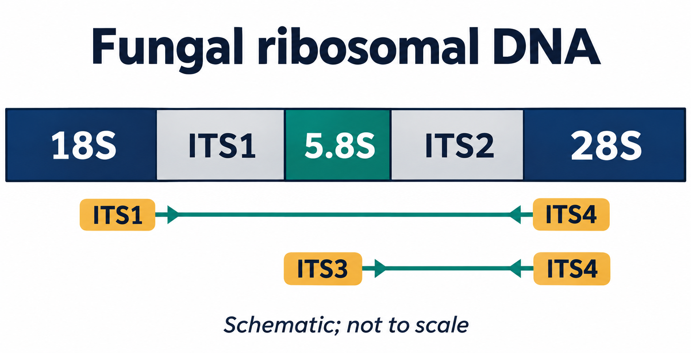  
*Figure 4.3. Full fungal ribosomal operon schematic showing the positioning of 18S, ITS1, 5.8S, ITS2, and 28S genes alongside universal primer pairs.*

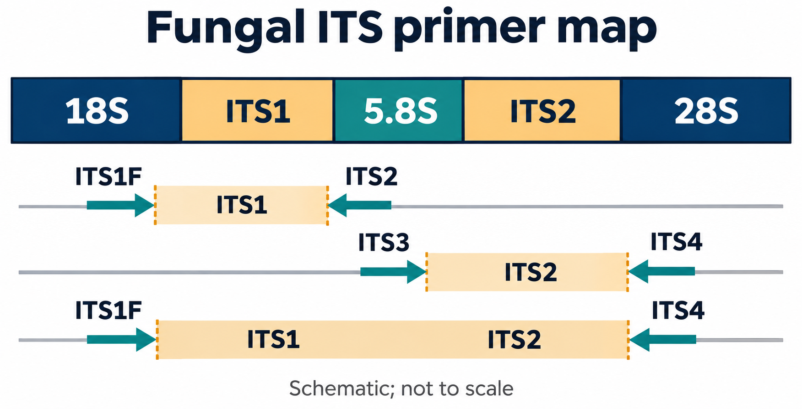  
*Figure 4.4. Detailed primer map across the fungal ITS region highlighting ITS1F, ITS2, ITS3, and ITS4 primer binding sites.*

---

#### 4.3 Eukaryotic and Microeukaryotic Markers (18S rRNA)

For broad eukaryotic biodiversity surveys—spanning unicellular protists, algae, fungi, and micro-invertebrates—the nuclear small subunit 18S rRNA gene (~1,800 bp) provides deep phylogenetic information. The 18S gene contains nine variable regions (V1–V9).

The V4 region (~380 bp, amplified with primers TAReuk454FWD1 / TAReukREV3) and V9 region (~130 bp, primers 1389F / 1510R) are standard choices for marine and freshwater plankton metabarcoding. Long-read nanopore amplicons spanning the near full-length 18S gene allow researchers to resolve divergent protistan clades that remain unclassified when sequenced over single short variable loops.

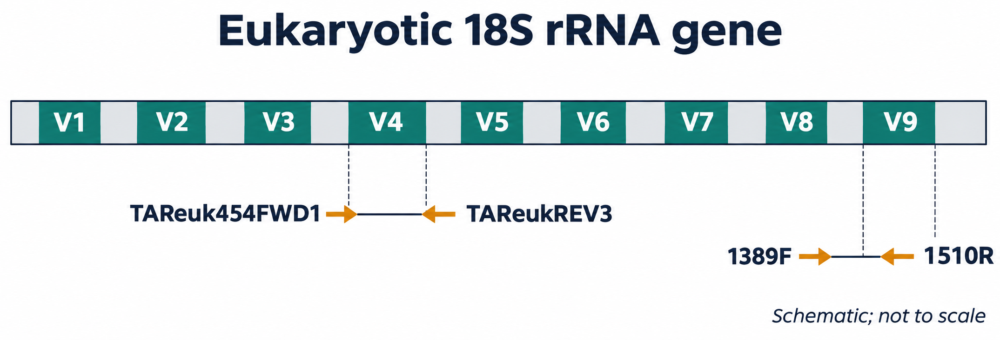  
*Figure 4.5. Eukaryotic 18S rRNA gene structure illustrating hypervariable regions V1–V9 and targets for universal eukaryotic primers.*

---

#### 4.4 Animal and Metazoan Markers (Mitochondrial COI)

Cytochrome *c* oxidase subunit I (COI) is the primary barcode for the animal kingdom (Hebert et al. 2003). The standard Folmer region (~658 bp) is amplified using primers LCO1490 and HCO2198. Due to the degeneracy of the universal primer sites across divergent invertebrate phyla, degenerate cocktails or internal mini-barcodes—such as the Leray fragment (~313 bp, amplified with mlCOIintF and jgHCO2198)—are widely used for marine benthic biodiversity and gut content analyses.

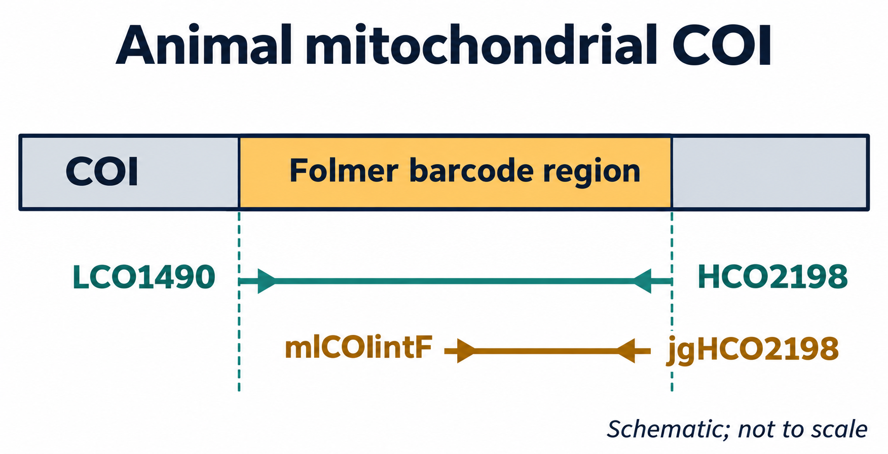  
*Figure 4.6. Mitochondrial COI gene showing the standard Folmer barcode region and the shorter Leray internal metabarcoding amplicon.*

---

#### 4.5 Vertebrate and Fish eDNA Markers (Mitochondrial 12S rRNA)

Environmental DNA (eDNA) shed into water columns by macro-organisms is typically fragmented into small segments (<300 bp) due to enzymatic, microbial, and photochemical degradation. For aquatic vertebrate and bony fish monitoring, the MiFish primer system (Miya et al. 2015) targets a hypervariable region of the mitochondrial 12S rRNA gene (~163–185 bp) using primers MiFish-U-F and MiFish-U-R.

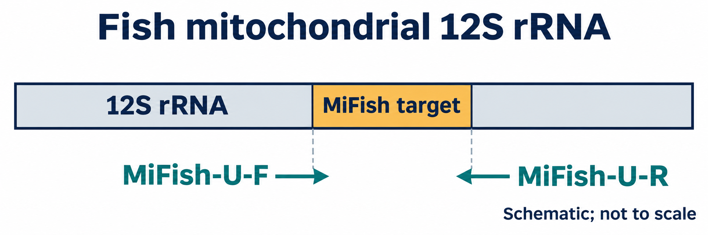  
*Figure 4.7. Vertebrate mitochondrial 12S rRNA gene schematic highlighting the short MiFish amplicon designed for aquatic eDNA biodiversity surveillance.*

---

#### 4.6 Plant Metabarcoding Markers (Chloroplast trnL)

For botanical community profiling, herbivore dietary analysis, and ancient sedimentary DNA, the chloroplast *trnL* (UAA) intron provides high taxonomic coverage across land plants. Taberlet et al. (2007) developed universal primers targeting the full *trnL* intron (primers c and d, ~400–600 bp) and the ultra-short internal P6 loop (primers g and h, 10–143 bp). The P6 loop's extreme brevity ensures robust amplification from heavily degraded DNA recovered from ancient permafrost cores, fossil faeces, and processed honey.

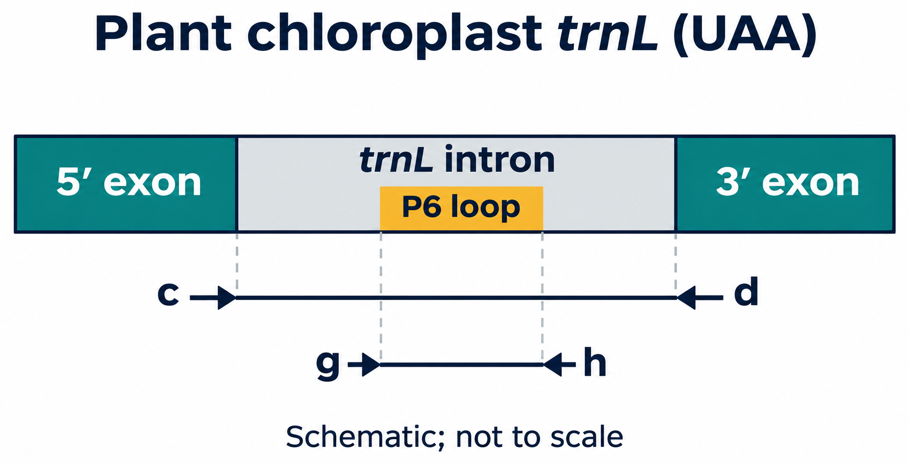  
*Figure 4.8. Chloroplast trnL gene locus showing the 5′ and 3′ exons, the full intron (primers c/d), and the ultra-short internal P6 loop (primers g/h).*

---

### Chapter 5. Sequencing Platform Selection

#### Table 5. Methodological trade-offs: short-read vs long-read amplicon sequencing
| Analytical Criterion | Short-Read Amplicon Sequencing (e.g. Illumina MiSeq) | Long-Read Nanopore Sequencing (ONT PromethION / MinION) |
|---|---|---|
| **Typical Target Length** | 250–500 bp (e.g. V3–V4 or V4 alone) | Full-length markers (1.5 kb 16S, 2.5 kb ITS-LSU, 4.5 kb operons) |
| **Taxonomic Resolution** | Often restricted to genus or family level; ambiguous species calls | Discriminates species and specific strains via complete variable suites |
| **Performance on Fragmented eDNA** | Highly robust; excels at short degraded amplicons (<200 bp) | Excels on intact amplicons; short amplicons require altered bead ratios |
| **Raw Per-Base Simplex Accuracy** | >99.9% (Q30+) | >99% (Q20+) with R10.4.1 chemistry and latest Dorado basecallers |
| **Run Turnaround and Flexibility** | Rigid batch runs; hours to days before data access | Continuous real-time streaming; runs can be stopped once target depth is met |
| **Compute & Pipeline** | Denoising into Amplicon Sequence Variants (ASVs via DADA2) | Alignment (minimap2) or k-mer classification (Kraken2/Bracken) |

---

### Chapter 6. Nanopore Sequencing Principles and Basecalling

#### 6.1 Biophysical Mechanism of Nanopore Sensing

Nanopore sequencing operates on an electro-physical measurement principle rather than sequencing-by-synthesis (SBS). A biological protein nanopore is embedded in a synthetic polymer membrane that exhibits high electrical resistance. The membrane separates two electrolyte-filled chambers (*cis* and *trans*). An applied voltage induces a steady ionic current of potassium ($K^+$) and chloride ($Cl^-$) ions through the central pore barrel.

A processive motor protein (derived from a helicase or polymerase), pre-loaded onto the sequencing adapter, docks at the pore opening on the *cis* side. Driven by the trans-membrane potential, the motor protein unwinds double-stranded DNA and steps single-stranded DNA through the pore lumen at a controlled velocity (~400 bases per second).

As nucleotides pass through the narrowest constriction of the pore (the reader head), they partially block the passage of ions. Because each base combination exhibits unique steric volume, spatial geometry, and electrical charge distribution, the electrical current fluctuates characteristically. High-bandwidth Application-Specific Integrated Circuit (ASIC) sensor arrays sample this ionic current thousands of times per second, recording a continuous current-versus-time trace (colloquially termed a "squiggle").

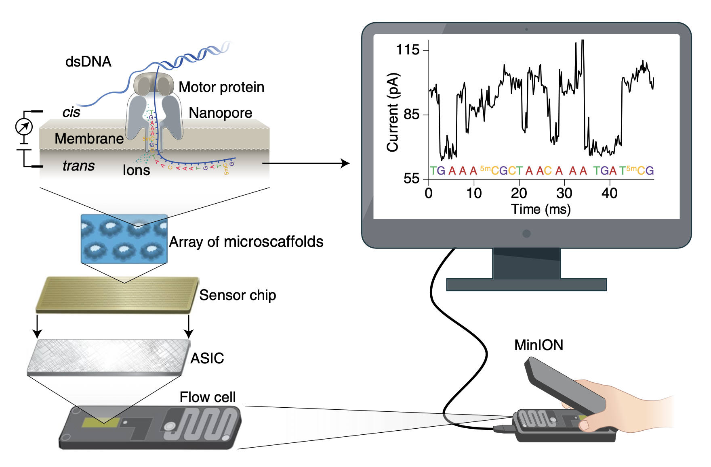  
*Figure 6.1. Comprehensive overview of nanopore sequencing architecture showing DNA translocation, the motor protein, sensor chip ASIC arrays, flow cell design, and real-time ionic current recording (from Wang et al. 2021).*

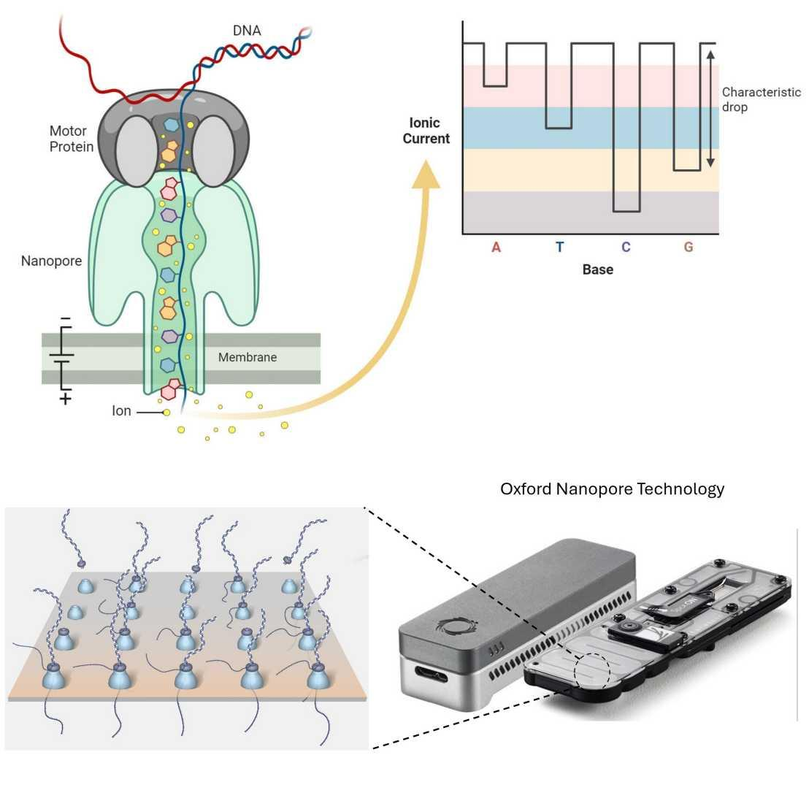  
*Figure 6.2. Physical schematic of single-molecule strand translocation through a biological nanopore membrane under constant voltage.*

---

#### 6.2 Pore Architecture: Evolution from R9.4.1 to R10.4.1 Dual Reader Heads

The evolution of ONT accuracy from ~90% in early chemistries to >99% (Q20+) today is largely driven by pore engineering. 

* **R9.4.1 Pores:** Utilized an engineered version of the *E. coli* curli transport protein CsgG, which contains a single reader constriction. Because approximately 4–5 nucleotides occupy this constriction simultaneously, the measured current reflects a compound k-mer. In long homopolymer tracts (e.g. `AAAAAAA`), the current level remains static as the identical bases move through, causing insertion/deletion (indel) errors and homopolymer miscounting.
* **R10.4.1 Pores:** Features an engineered longer barrel with **two distinct reader heads** spaced vertically inside the pore channel. As a DNA strand translocates, nucleotides are read consecutively by both constrictions at slightly shifted intervals. This dual-sensing mechanism breaks the homopolymer degeneracy, vastly improving raw read accuracy, resolving homopolymers beyond 10 bp, and delivering modal raw simplex read accuracies exceeding Q20 (99%).

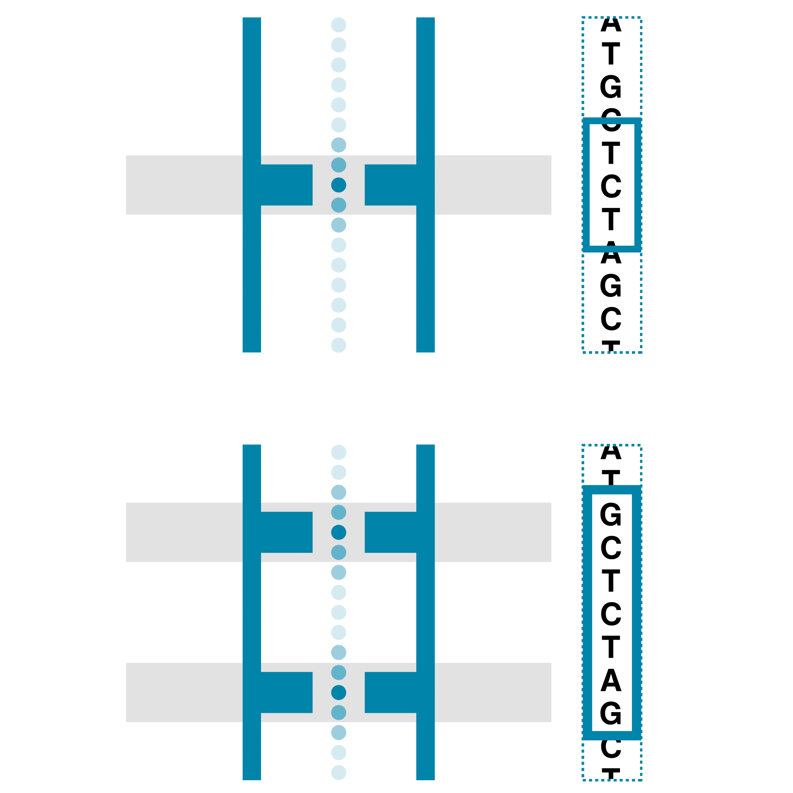  
*Figure 6.3. Comparison between single-constriction R9.4.1 and dual-constriction R10.4.1 nanopore barrels, illustrating how dual reader heads resolve ambiguous homopolymer current levels.*

---

#### 6.3 Neural Network Basecalling: Decoding Raw Ionic Currents into Nucleotides

Nanopore raw ionic current traces do not exhibit a simplistic one-to-one relationship where a specific current value equals an isolated base. Instead, the signal represents a continuous, noisy time series where each instantaneous measurement is influenced by the 4–6 nucleotides situated within the reader constriction.

ONT’s modern basecalling engine—**Dorado**—decodes raw signal stored in `POD5` files using deep neural network architectures:
1. **Convolutional Neural Networks (CNNs):** Scan raw current samples to extract low-level local signal features, normalizing baseline drifts and transient pore noise.
2. **Bi-directional Recurrent Neural Networks (RNNs) / Transformers:** Model long-range contextual temporal dependencies across adjacent current shifts.
3. **Connectionist Temporal Classification (CTC) / Modified Beam Search:** Decodes hidden neural layer states into discrete nucleotide calls (`A`, `C`, `G`, `T`) while assigning a probabilistic Phred quality score ($Q$) to every individual base call.

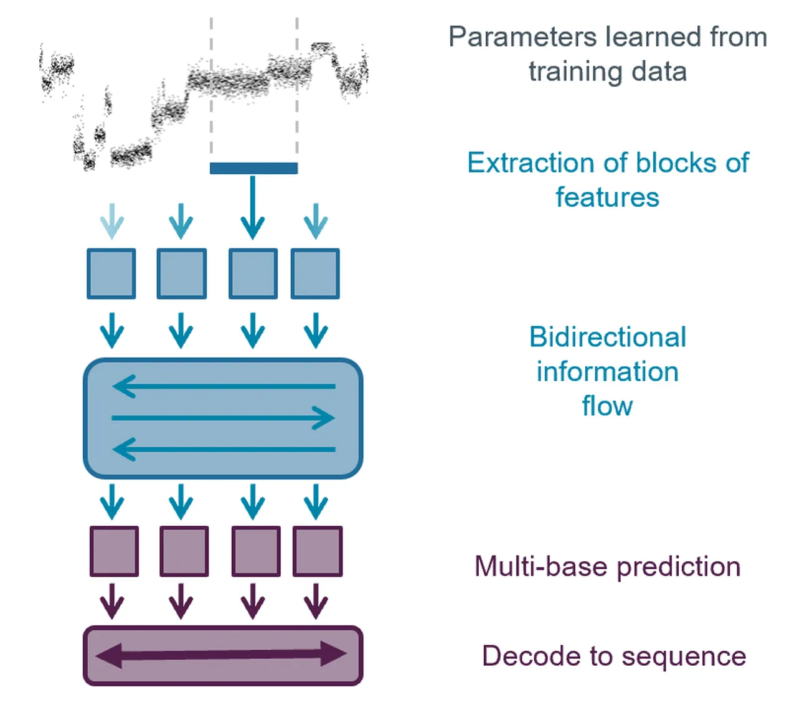  
*Figure 6.4. Deep neural network basecalling workflow showing raw electrical current processing, feature extraction, neural state probability matrices, and nucleotide sequence decoding.*

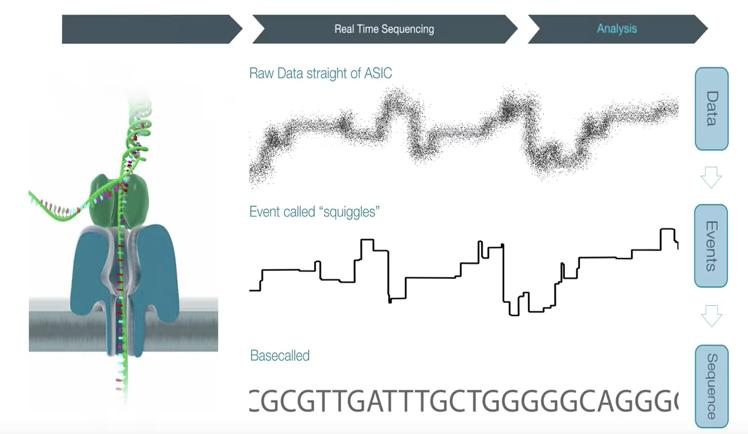  
*Figure 6.5. Conversion of continuous ionic current traces into basecalled FASTQ sequences with per-base quality metrics.*

---

### Chapter 7. ONT Instrumentation and Experimental Planning

#### Table 6. Oxford Nanopore sequencing platforms
| Platform | Form Factor | Flow Cell Capacity | Active Pores per Flow Cell | Ideal Amplicon Sequencing Scope |
|---|---|---|---|---|
| **MinION Mk1B / Mk1D** | Portable, USB-powered | 1 MinION / Flongle cell | 512 channels (up to 2,048 pores) | Field sequencing, point-of-care diagnostics, teaching labs, small multiplex pools |
| **GridION** | Benchtop with onboard GPU compute | Up to 5 MinION flow cells | Up to 2,560 channels | Core facility daily throughput; parallel multi-sample barcoded amplicon runs |
| **PromethION 2 Solo / 24 / 48** | High-throughput enterprise instrument | 2, 24, or 48 PromethION cells | 3,000 channels (~5,000 active pores) | Large-scale population surveys, massive amplicon multiplexing (thousands of samples) |

#### Experimental Planning Guidelines
* **Sample Multiplexing:** Native Barcoding Kit 24 V14 provides 24 unique barcodes (`NB01`–`NB24`), enabling 24 distinct samples per flow cell `[MFR]`.
* **Reserve Barcodes for Quality Controls:** Always allocate barcodes to an extraction blank, a PCR no-template control (NTC), and an optional positive mock community.
* **Target Sequencing Depth:** For bacterial 16S community profiling, 20,000 to 50,000 classified reads per sample provide comprehensive coverage of abundant and moderately rare taxa. On a PromethION flow cell yielding millions of reads, 24 samples will reach saturating depth rapidly, allowing the run to be stopped early or multiplexed at higher barcode tiers.
* **Flow Cell Quality Check:** Always perform an electronic flow cell check via MinKNOW within 12 weeks of purchase. The manufacturer warranty guarantees a minimum of 5,000 active sequencing pores on a new PromethION flow cell `[MFR]`.
* **Consumable Compatibility:** The native barcoding amplicon protocol requires R10.4.1 PromethION flow cells (`FLO-PRO114M`) `[MFR]`.

---

## Part B – ONT Laboratory Workflow

### Chapter 8. Laboratory Workflow Overview

  
*Figure 8.1. High-level laboratory workflow tracing samples from collection through PCR, library construction, PromethION sequencing, and bioinformatic classification.*

#### Sample Collection and DNA Extraction
Samples must be collected using sterile, DNA-free tools and immediately preserved (flash freezing at −80 °C, preservation in 95% molecular ethanol, or stabilization in lysis buffers). Chemical impurities commonly co-extracted from environmental matrices—including humic acids, polyphenols, polysaccharides, residual SDS, phenol, or ethanol—inhibit PCR polymerases and poison nanopores. Spectrophotometric purity guidelines (`[MFR]`):
* **$A_{260} / A_{280}$ ratio:** 1.8 to 2.0 (lower values indicate protein or phenol contamination).
* **$A_{260} / A_{230}$ ratio:** 2.0 to 2.2 (lower values indicate carbohydrate, humic acid, or salt carryover).

#### Marker PCR
Amplify marker targets using high-fidelity, proofreading DNA polymerases. Maintain the lowest cycle count that yields a detectable band (typically 25–30 cycles); excessive cycling exponentially increases chimera formation and skewing caused by template exhaustion (Kebschull & Zador 2015).

#### Table 7. Critical experimental controls
| Control Type | Point of Introduction | Diagnostic Value |
|---|---|---|
| **Extraction Blank (Kitome Control)** | DNA Extraction step | Detects background contaminants originating from commercial extraction spin columns and lysis reagents |
| **PCR No-Template Control (NTC)** | PCR Amplification step | Identifies cross-contamination, aerosol carryover, or primer-dimer artifacts |
| **Mock Community Positive Control** | Extraction or PCR | Calibrates PCR amplification bias, chimera rates, and taxonomic classification accuracy against known standards |
| **DNA Control Sample (DCS)** | End-Preparation step | A standard 3.6 kb Lambda DNA fragment confirming that end-repair and ligation chemistries functioned correctly `[MFR]` |

> [!WARNING]
> In ONT terminology, "PCR-free" refers strictly to the library preparation chemistry: no PCR amplification is performed during end-prep, barcoding, or adapter ligation. However, the starting amplicon input material was generated via PCR prior to library entry.

---

### Chapter 9. Native Barcoding Kit V14 Guided Practical

> [!NOTE]
> Protocol specifications follow ONT *Ligation Sequencing Amplicons – Native Barcoding Kit 24 V14 (`SQK-NBD114.24`), PromethION variant*, rev. NBA_9168_v114_revU_15Jul2026.

#### Table 8. Reagents and consumables compatibility `[MFR]`
| Reagent / Hardware | Catalog Number |
|---|---|
| **Native Barcoding Kit 24 V14** | `SQK-NBD114.24` |
| **PromethION Flow Cell (R10.4.1)** | `FLO-PRO114M` |
| **Flow Cell Wash Kit** | `EXP-WSH004` |
| **Sequencing Auxiliary Vials V14** | `EXP-AUX003` |
| **NEBNext Ultra II End Repair / dA-Tailing Module** | NEB `E7546` |
| **NEB Blunt/TA Ligase Master Mix** | NEB `M0367` |
| **NEBNext Quick Ligation Module** | NEB `E6056` |
| **AMPure XP Magnetic Beads** | Beckman Coulter `A63881` |

---

#### 9.1 Preparing and Evaluating PCR Amplicons

**Objective:** Verify amplicon length, confirm absence of non-specific bands, quantify concentration via fluorometry, and calculate exact molar inputs.  
**Principle:** Enzymatic ligation kinetics depend strictly on the molar concentration of available DNA termini (fmol), not on mass (ng). Equal mass does not mean equal molecules.

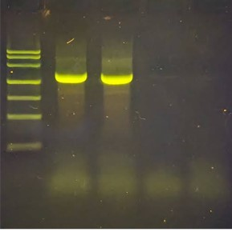  
*Figure 9.1. Agarose gel electrophoresis verifying full-length 16S rRNA amplicons (~1.5 kb). A clean, distinct single band indicates high amplicon purity suitable for library preparation without non-specific off-target products.*

#### Procedural Steps
1. Load 1–3 µL of PCR product alongside a DNA size ladder on a 1.5% agarose gel. Verify a single discrete band at the expected amplicon length (~1.5 kb for 16S).
2. Quantify amplicon concentration using the Qubit dsDNA High Sensitivity (HS) assay. Do not rely on NanoDrop $A_{260}$ spectrophotometry, which severely overestimates amplicon concentration in the presence of unincorporated dNTPs and primers.
3. Calculate the DNA mass required to deliver **200 fmol** per sample `[MFR]`.

> [!TIP]
> **Mass-to-Molarity Formula for dsDNA:**  
> $$\text{Mass (ng)} \approx \frac{\text{fmol} \times \text{Length (bp)} \times 660}{1{,}000{,}000}$$  
> For **200 fmol** of a **1,500 bp** full-length 16S amplicon:  
> $$\text{Mass} \approx \frac{200 \times 1{,}500 \times 660}{10^6} \approx \mathbf{198\text{ ng}}$$

#### Table 9. Mass vs molarity comparison across amplicon lengths `[EX]`
| Amplicon Fragment Length | Mass Required for 200 fmol | Molar Amount in 130 ng of DNA |
|---|---|---|
| **500 bp** | 66.0 ng | 394 fmol |
| **800 bp** | 105.6 ng | 246 fmol |
| **1,000 bp** | 132.0 ng | 200 fmol |
| **1,500 bp (Full-length 16S)** | 198.0 ng | 131 fmol |

---

#### 9.2 End-Preparation: Preparing DNA for Ligation

**Objective:** Repair ragged DNA ends, phosphorylate 5′ termini, and append a single 3′ deoxyadenosine (dA) overhang to facilitate cohesive TA ligation of Native Barcodes.

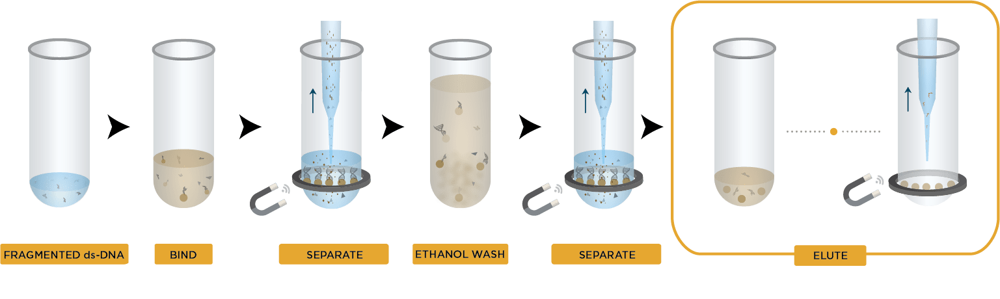  
*Figure 9.2. Magnetic bead cleanup principle showing DNA binding to carboxylated paramagnetic beads in PEG/NaCl, washing in ethanol, and elution in pure water.*

#### Table 10. End-preparation reaction composition `[MFR]`
| Component | Volume per Reaction |
|---|---|
| Amplicon DNA (200 fmol) | 11.5 µL |
| Diluted DNA Control Sample (DCS) *[Optional]* | 1.0 µL |
| Ultra II End-prep Reaction Buffer | 1.75 µL |
| Ultra II End-prep Enzyme Mix | 0.75 µL |
| **Total Reaction Volume** | **15.0 µL** |

#### Incubation and Clean-up Procedure
1. Program a thermal cycler: **20 °C for 5 minutes** (end-repair), followed by **65 °C for 5 minutes** (heat inactivation of enzyme and dA-tailing).
2. Transfer the 15 µL reaction to a clean 1.5 mL DNA LoBind tube.
3. Add **15 µL thoroughly resuspended AMPure XP beads (1.0× ratio)**. Mix gently by flicking or pipetting. Incubate on a rotator for 5 minutes at room temperature.
4. Pellet beads on a magnetic rack until the supernatant clarifies completely (~2 minutes). Discard supernatant.
5. Wash the bead pellet twice with **200 µL freshly prepared 80% ethanol**, taking care not to disturb the bead pellet.
6. Air-dry the pellet briefly (~30 seconds). Avoid over-drying until cracks appear, which significantly impairs elution.
7. Resuspend the pellet in **10 µL nuclease-free water**. Incubate for 2 minutes at room temperature, place on the magnet, and retain the 10 µL clarified eluate.
8. Quantify 1 µL using Qubit dsDNA HS to determine recovery yield.

> [!WARNING]
> Never vortex the Ultra II End Prep Enzyme Mix. Mix reagents by gentle pipetting. Prepare 80% ethanol fresh daily; diluted ethanol below 70% will prematurely elute DNA from the beads.

---

#### 9.3 Native Barcode Ligation and Sample Multiplexing

**Objective:** Ligate unique double-stranded native barcode identifiers (`NB01`–`NB24`) to the dA-tailed amplicon ends, allowing up to 24 samples to be pooled and sequenced together.

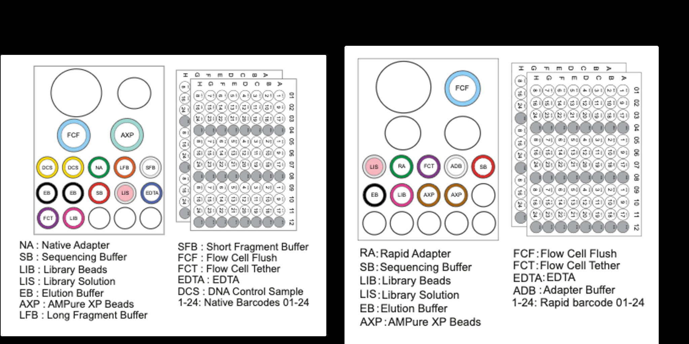  
*Figure 9.3. Reagent layout and tube formats for Native Barcoding Kit (SQK-NBD114.24) and Rapid Barcoding Kit workflows.*

#### Table 11. Barcode ligation reaction composition `[MFR]`
| Component | Volume per Sample |
|---|---|
| End-prepped Amplicon DNA | 7.5 µL |
| Native Barcode (`NB01` through `NB24`) | 2.5 µL |
| Blunt/TA Ligase Master Mix | 10.0 µL |
| **Total Reaction Volume** | **20.0 µL** |

#### Procedural Steps
1. Carefully log barcode assignments in the sample tracking sheet (Appendix B). Native barcode vials are single-use.
2. Combine components in the order listed; mix by pipetting 10–20 times.
3. Incubate at room temperature (**20–25 °C**) for **20 minutes**.
4. Add **4 µL of 0.2 M EDTA** to each tube and mix thoroughly to quench ligase activity.
5. **Pool all reactions** into a single 1.5 mL LoBind tube.
6. Perform magnetic bead purification using a **0.4× AMPure XP ratio** (see Table 12).
7. Wash the pooled pellet twice using **700 µL Short Fragment Buffer (SFB)**. *Do not use ethanol.*
8. Resuspend pellet in **35 µL nuclease-free water**, incubate at 37 °C for 10 minutes, pellet on magnet, and transfer the 35 µL pooled library eluate to a clean tube.

#### Table 12. Pooling volumes and 0.4× bead cleanup arithmetic `[MFR]`
| Number of Multiplexed Samples | Pooled Volume (with EDTA) | 0.4× AMPure XP Bead Volume |
|---|---|---|
| **6 Samples** | 144 µL | 58 µL |
| **12 Samples** | 288 µL | 115 µL |
| **24 Samples** | 576 µL | 230 µL |

> [!WARNING]
> Always verify sample-to-barcode mappings before pooling. Once tubes are combined, sample identities cannot be recovered if mislabeled.

---

#### 9.4 Sequencing Adapter Ligation and Final Library Clean-up

**Objective:** Attach the Native Adapter (NA) to both ends of the pooled, barcoded amplicons. The Native Adapter carries the sequencing motor protein that engages the nanopore reader.

#### Table 13. Adapter ligation reaction composition `[MFR]`
| Component | Volume |
|---|---|
| Pooled Barcoded Library | 30.0 µL |
| Native Adapter (NA) | 5.0 µL |
| NEBNext Quick Ligation Reaction Buffer (5×) | 10.0 µL |
| Quick T4 DNA Ligase | 5.0 µL |
| **Total Reaction Volume** | **50.0 µL** |

#### Incubation and Final Clean-up
1. Incubate the reaction at room temperature for **20 minutes**.
2. Add **20 µL AMPure XP beads** (0.4× ratio), rotate for 10 minutes at room temperature, and pellet on the magnet.
3. Wash the pellet twice with **125 µL Short Fragment Buffer (SFB)**.
4. Resuspend the pellet in **25 µL Elution Buffer (EB)**, incubate for 10 minutes at 37 °C, pellet, and retain the clarified library.
5. Quantify 1 µL via Qubit dsDNA HS. Prepare the final library loading amount in **32 µL Elution Buffer (EB)**.

#### Table 14. Wash buffer selection criteria `[MFR]`
| Wash Buffer | Fragment Size Retention | Protocol Guidance |
|---|---|---|
| **Short Fragment Buffer (SFB)** | Retains fragments of all sizes down to ~150 bp | Mandatory for full-length 16S amplicons (~1.5 kb) and shorter targets |
| **Long Fragment Buffer (LFB)** | Selectively enriches fragments $\ge 3\text{ kb}$ | Used strictly for genomic DNA libraries; severely depletes amplicons |

> [!WARNING]
> Never use ethanol during post-adapter wash steps! Ethanol denatures the motor protein attached to the Native Adapter, dropping flow cell pore occupancy to near zero.

#### Table 15. Flow cell loading guidelines by library fragment length `[MFR]`
| Library Insert Size | Recommended Loading Amount (in 32 µL EB) |
|---|---|
| **<1,000 bp (Short amplicons)** | 100 fmol |
| **1,000–10,000 bp (Full-length 16S)** | 35–50 fmol |
| **>10,000 bp (Long genomic fragments)** | 300 ng |

---

#### 9.5 Priming and Loading the PromethION Flow Cell

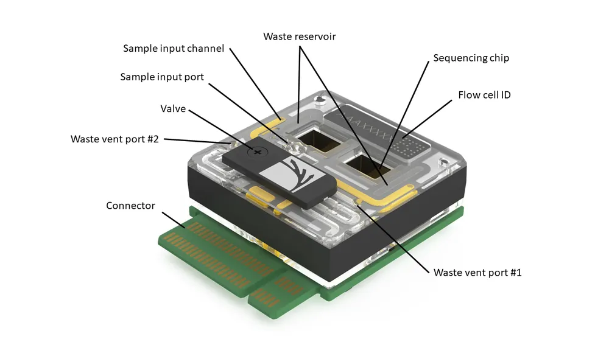  
*Figure 9.4. PromethION flow cell 3D diagram showing fluidic ports, internal sensor micro-channels, waste ports, and electrical contact pin arrays.*

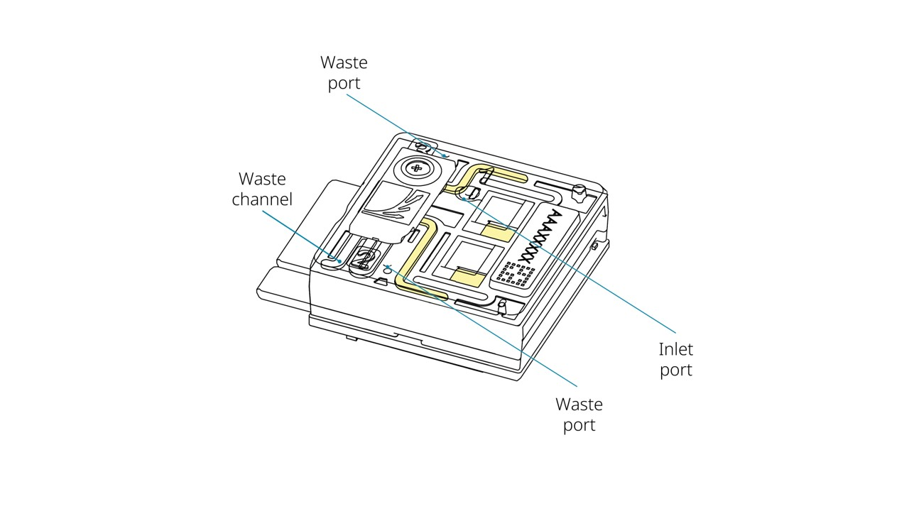  
*Figure 9.5. Detailed anatomy of the PromethION flow cell fluidic architecture and inlet loading port.*

#### Table 16. Flow cell priming mix `[MFR]`
| Reagent | Volume |
|---|---|
| Flow Cell Flush (FCF) | 1,170 µL |
| Flow Cell Tether (FCT) | 30 µL |
| **Total Volume** | **1,200 µL** |

#### Table 17. Final PromethION library loading mix `[MFR]`
| Reagent | Volume |
|---|---|
| Sequencing Buffer (SB) | 100 µL |
| Library Beads (LIB) *[Thoroughly vortexed]* or Library Solution (LIS) | 68 µL |
| Prepared DNA Library (in EB) | 32 µL |
| **Total Loading Volume** | **200 µL** |

#### Flow Cell Priming and Loading Steps
1. Equilibrate the flow cell to room temperature for at least 20 minutes before unsealing.
2. Insert the flow cell into the PromethION bay. Ensure smooth horizontal entry; pushing at an awkward angle bends the delicate electrical contact pins.
3. Slide the inlet port cover clockwise to expose the loading port.
4. Set a P1000 pipette to 200 µL. Insert the tip into the inlet port and gently draw back only until a tiny bead of liquid enters the tip (no more than 20–30 µL) to clear any residual air bubbles.
5. Slowly introduce **500 µL of priming mix** through the inlet port. Wait **5 minutes**.
6. Vortex Library Beads (LIB) thoroughly immediately before pipetting; beads settle within seconds. Prepare the 200 µL loading mix.
7. Introduce the second **500 µL of priming mix**.
8. Gently load the **200 µL library loading mix** through the inlet port.
9. Close the inlet port cover. Fit the PromethION Light Shield over the flow cell window and close the instrument lid.
10. Wait 10 minutes before starting the sequencing run in MinKNOW to allow the library to tether to the membrane.

#### Table 18. Physical failure modes and troubleshooting `[MFR]`
| Observed Failure | Biological / Physical Cause | Corrective Action |
|---|---|---|
| **Air bubble introduced into array** | Irreversible physical destruction of active lipid bilayer membranes | Always draw back a small volume before loading; dispense priming mix smoothly without introducing bubbles |
| **Pore occupancy near 0%** | Flow Cell Tether (FCT) omitted, or ethanol used in adapter clean-up | Always add FCT to FCF priming mix; ensure only SFB is used after adapter ligation |
| **Low sequencing pore occupancy (<40%)** | Under-loaded library or settled Library Beads | Accurately quantify library via Qubit; vortex LIB vigorously immediately before mixing |
| **Rapid pore degradation during run** | Chemical contaminant carryover (phenol, polysaccharides) | Re-purify amplicons with an additional bead wash; execute a Nuclease Flush (`EXP-WSH004`) |

---

#### 9.6 MinKNOW Run Configuration and Data Generation

MinKNOW coordinates real-time data acquisition, voltage control, and neural network basecalling.

1. **Start Sequencing:** Navigate to the **Start** tab, select the flow cell position, enter the Experiment Name and Sample ID, and confirm flow cell chemistry (`FLO-PRO114M`).
2. **Kit Selection:** Select **Native Barcoding Kit 24 V14 (`SQK-NBD114.24`)**. Selecting this kit configures MinKNOW to demultiplex reads automatically during acquisition.
3. **Run Options:** Set sequencing duration (typically 24–48 hours, or stop manually when sufficient reads are collected) and minimum read length filter (e.g. 200 bp).
4. **Basecalling Settings:** Enable real-time basecalling. Select High Accuracy (HAC) or Super Accuracy (SUP) models depending on local GPU compute capacity. Enable barcode trimming and mid-read barcode filtering.
5. **Output Formats:** Select `POD5` for raw electrical current storage and `FASTQ` for basecalled reads with per-base quality scores.

---

#### 9.7 From FASTQ to Biological Interpretation (`wf-16s` Walkthrough)

EPI2ME `wf-16s` is the official Nextflow bioinformatics pipeline developed by Oxford Nanopore for microbial amplicon analysis. It accepts demultiplexed FASTQ files and executes quality filtering, taxonomic assignment, and interactive HTML reporting.

#### Pipeline Parameters
* **`classifier`:** Choose between `minimap2` (pairwise reference alignment, recommended for fine species resolution) or `kraken2` (k-mer matching with Bracken abundance re-estimation, faster execution).
* **`database_set`:** Default is `ncbi_16s_18s` (updated NCBI targeted loci covering bacteria, archaea, and fungi). For fungal ITS amplicons, change to `ncbi_16s_18s_28s_ITS`.
* **Read-Length Filtering:** Default `min_len` is 800 bp and `max_len` is 2,000 bp. For short amplicons (e.g. fungal ITS or fish 12S), `min_len` must be adjusted downward (e.g. 300 bp or 100 bp).
* **Alignment Thresholds:** `min_percent_identity: 95` and `min_ref_coverage: 90`. Reads falling below these thresholds remain categorized as "Unclassified".

---

## Part C – Bioinformatics

### Chapter 10. Nanopore Data Formats and Basecalling

#### Table 19. File formats in the nanopore computational lifecycle
| File Format | Primary Data Content | Long-term Archival Recommendation |
|---|---|---|
| **`POD5`** | Raw ionic current measurements, sampling timestamps, and pore channel telemetry | **Permanent archive.** Allows raw electrical signals to be re-basecalled in future years with improved neural network models |
| **`FASTQ` (`.fastq.gz`)** | Basecalled nucleotide strings with ASCII-encoded per-base Phred quality scores | **Working archive.** Primary input for downstream alignment, taxonomic classification, and variant analysis |
| **`Sample Sheet` (`.csv`)** | Metadata mapping experimental barcodes (`barcode01`–`barcode24`) to biological aliases | **Permanent archive.** Critical for sample traceability and demultiplexing |
| **`HTML Report & Abundance Tables`** | Interactive community visualizer, taxonomic abundance matrices, and QC charts | **Final deliverable.** Communicates biological findings |

$$\text{Phred Quality Score: } Q = -10 \cdot \log_{10}(P_{\text{error}})$$

#### Table 20. Phred quality scores and base accuracy
| Phred $Q$ Score | Probability of Incorrect Base Call ($P_{\text{error}}$) | Base Call Accuracy Percentage |
|---|---|---|
| **$Q10$** | 1 in 10 | 90.0% |
| **$Q20$** | 1 in 100 | 99.0% |
| **$Q30$** | 1 in 1,000 | 99.9% |

---

### Chapter 11. Quality Control and Taxonomic Assignment

#### Read Quality Control
1. **Length Distribution:** A clean amplicon library produces a sharp unimodal peak centered at the expected marker length (~1,500 bp for 16S). Broad distributions, bimodal profiles, or short tails indicate primer-dimers, chimeras, or degraded input templates.
2. **Quality Score Distribution:** Examine mean Phred scores per barcode; modal quality should exceed Q15–Q20 with modern Dorado models.
3. **Demultiplexing Efficiency:** Confirm that reads are distributed evenly across biological barcodes and that negative control barcodes (`NTC`, `Extraction Blank`) contain negligible read counts.

#### Table 21. Taxonomic classification algorithms in `wf-16s`
| Feature | Alignment Approach (`minimap2`) | k-mer Matching (`Kraken2` + `Bracken`) |
|---|---|---|
| **Mechanism** | Aligns full query read against reference database; requires strict identity and reference coverage thresholds | Breaks query reads into k-mers (e.g. $k=35$); finds lowest common ancestor (LCA) in a precomputed taxon tree |
| **Strengths** | Superior species-level discrimination; reports actual alignment identity and coverage | Extremely fast processing; modest RAM requirements |
| **Caveats** | Slower on large databases; stringent thresholds increase the unclassified fraction | Sensitive to database completeness; may over-classify noisy reads |

---

### Chapter 12. Community Visualization and Interpretation

  
*Figure 12.1. Illustrative stacked bar plot displaying relative taxonomic composition across samples. Relative sequence proportions must not be conflated with absolute organism abundance.*

#### Understanding Diversity Metrics
* **Alpha Diversity (Within-sample Diversity):**
  * **Species Richness ($S$):** Total count of unique taxa detected in a sample.
  * **Shannon Index ($H = -\sum p_i \ln p_i$):** Quantifies both richness and evenness; values decrease when a single taxon dominates.
  * **Simpson Index ($D = \sum p_i^2$):** Measures the probability that two randomly selected reads belong to the same taxon.
  * **Pielou’s Evenness ($J = H / \ln S$):** Normalizes Shannon diversity on a scale from 0 (complete dominance) to 1 (perfect equitability).
* **Beta Diversity (Between-sample Diversity):** Evaluates compositional turnover between distinct environments using Bray-Curtis dissimilarity, Jaccard distance, or phylogenetic UniFrac metrics visualized via Principal Coordinates Analysis (PCoA).

> [!WARNING]
> **Relative abundance is not population size.** If taxon A yields twice as many reads as taxon B, you cannot conclude that twice as many living cells were present:
> 1. Ribosomal RNA gene copy numbers vary substantially between microbial genomes (from 1 copy in many oligotrophic taxa to >15 copies in spore-forming *Bacillus*).
> 2. Cell wall structures (Gram-positive peptidoglycan vs. Gram-negative membranes) cause unequal cell lysis efficiencies during DNA extraction.
> 3. Amplicon sequence data are inherently compositional: percentages sum to 100%, meaning that an expansion in one taxon mathematically depresses the measured relative proportions of all other community members.

---

## Part D – Critical Evaluation and Synthesis

### Chapter 13. Limitations and Troubleshooting

#### Table 22. Benefits versus methodological limitations in amplicon sequencing
| Inherent Strengths | Methodological Limitations & Analytical Pitfalls |
|---|---|
| **Culture-Independent Surveillance** | **PCR Amplification Bias:** Universal primers never amplify every lineage with equal thermodynamic efficiency |
| **Full-Length Marker Discrimination** | **Reagent Contamination (The "Kitome"):** Low-biomass samples are easily masked by contaminants in extraction columns |
| **Real-Time Data Acquisition** | **Barcode Index Switching:** Low-level demultiplexing crosstalk can introduce false-positive read calls |
| **High Multiplexing Capacity** | **Database Incompleteness:** Unrepresented taxa are forced into incorrect sister clades or labeled "Unclassified" |

#### Table 23. Comprehensive symptom-cause-action troubleshooting guide
| Observation / Error | Probable Underlying Cause | Recommended Corrective Action |
|---|---|---|
| **Low recovery after bead clean-up (<20%)** | Ethanol concentration <70%; beads settled; bead-to-sample ratio too low (<0.4×) | Prepare 80% ethanol fresh daily; vortex beads vigorously; verify bead ratio against amplicon fragment length |
| **Pore occupancy <40% at run start** | Under-loaded library; library beads settled prior to loading | Re-quantify library with Qubit; vortex LIB beads immediately before mixing; reload additional library |
| **Pore occupancy collapses near 0%** | Ethanol wash used after adapter ligation; Flow Cell Tether (FCT) omitted | Strictly wash with SFB/LFB after adapter attachment; ensure FCT is added to FCF priming mix every time |
| **Available pores drop sharply below flow cell check** | Air bubble introduced during priming/loading; damaged electrical contact pins | Draw back 20 µL to clear bubbles before dispensing; insert flow cells smoothly at a level horizontal angle |
| **Rapid accumulation of "Inactive" pores** | Co-extracted chemical inhibitors (polyphenols, humic acids, protein carryover) | Perform additional 0.4× bead cleanup; execute a flow cell nuclease flush using the Flow Cell Wash Kit (`EXP-WSH004`) |
| **Mean read length substantially shorter than expected** | Degraded starting DNA; vortex shearing of amplicons | Check PCR products on an agarose gel; mix libraries by gentle flicking or wide-bore pipetting—never vortex |
| **High read counts in negative controls (NTC/Blank)** | Reagent contamination; cross-contamination during pooling; aerosol carryover | Treat taxa present in controls at similar levels as contaminants; clean PCR stations with UV/bleach; use filter tips |
| **Excessive fraction of "Unclassified" reads (>30%)** | Reference database lacks target taxa; alignment identity/coverage thresholds too stringent | Inspect unclassified reads via BLAST; test broader databases (e.g. SILVA vs NCBI); verify primer trimming |

---

### Chapter 14. Summary, Synthesis and Further Reading

#### Core Takeaways
1. **Targeted Strategy:** Amplicon sequencing is a marker-directed molecular census. Platform and marker selection determine the taxonomic boundary and biological resolution of the experiment.
2. **Stoichiometric Rigor:** Library chemistry is driven by molar concentration (fmol), not mass (ng). Accurate fluorometric quantification and fragment size conversion are mandatory.
3. **Experimental Quality Controls:** Negative blanks, no-template controls, and mock communities are essential to distinguish true biological signals from kit contaminants and PCR artifacts.
4. **Critical Interpretation:** Sequence read counts represent relative compositional fractions, not absolute cell numbers. High-confidence conclusions require integrating taxonomic results with ecological context.

#### Review Questions and Answers
#### Table 24. Conceptual review questions and answers
| # | Question | Detailed Scientific Explanation |
|---|---|---|
| **1** | Why do equal masses of two different amplicons contain unequal numbers of DNA molecules? | DNA molecular weight scales linearly with base pair length ($M \approx \text{bp} \times 660\text{ g/mol}$). A shorter fragment has fewer grams per mole; consequently, 100 ng of a 500 bp amplicon contains three times as many individual double-stranded molecules as 100 ng of a 1,500 bp amplicon. |
| **2** | Which phase makes the Native Barcoding library "PCR-free", and where does PCR occur? | The Native Barcoding Kit (SQK-NBD114.24) is "PCR-free" during library construction because barcodes and adapters are attached via enzymatic end-repair and cohesive TA-ligation without subsequent cycles of PCR amplification. However, the input amplicon DNA was generated by PCR prior to library prep. |
| **3** | Why is an extraction negative control mandatory even when multiplexing with native barcodes? | Native barcodes separate multiplexed biological samples from one another during bioinformatic demultiplexing, but they cannot eliminate background DNA present in extraction spin columns, lysis buffers, or enzymes ("the kitome"). Sequencing the extraction blank identifies baseline contaminant taxa that must be filtered out. |
| **4** | State three distinct reasons why relative read counts do not directly correspond to living organism cell counts. | (1) Ribosomal RNA gene copy numbers vary from 1 to >15 copies across bacterial genomes; (2) Differential cell wall lysis efficiencies cause unequal DNA extraction recovery; (3) DNA sequence counts are compositional proportions that sum to 100%, making read shares interdependent. |
| **5** | What parameters must change if applying this workflow to a short 170 bp fish 12S eDNA amplicon instead of 1,500 bp 16S? | (1) The magnetic bead cleanup ratio must be increased from 0.4× to >1.0× to avoid discarding short fragments; (2) The final library loading target must increase to ~100 fmol; (3) `wf-16s` read-length filters (`min_len: 800`) must be lowered to ~100 bp; (4) The reference database must be swapped from bacterial 16S to curated vertebrate 12S libraries. |
| **6** | What implicit assumptions govern the default parameter settings of EPI2ME `wf-16s`? | The workflow assumes intact, full-length bacterial/archaeal 16S amplicons (length window 800–2,000 bp), pairwise alignment with minimap2 requiring $\ge 95\%$ identity and $\ge 90\%$ reference coverage, and classification against the NCBI 16S/18S ribosomal targeted loci database. |

#### Synthesis: Adapting Workflows to Environmental DNA (eDNA) Metabarcoding
When transitioning from full-length bacterial 16S sequencing to aquatic eDNA monitoring (such as fish biodiversity surveys using mitochondrial 12S primers), laboratory and bioinformatic parameters must be deliberately adapted rather than blindly copied:

#### Table 25. Workflow adaptations: Full-length 16S vs Short 12S eDNA `[ADAPT]`
| Protocol Parameter | Full-Length 16S Workflow | Short 12S Fish eDNA Workflow |
|---|---|---|
| **Typical Target Size** | ~1,500 bp | ~163–185 bp (MiFish) |
| **Pooled Bead Cleanup Ratio** | 0.4× AMPure XP (selects against <1 kb) | Must increase to 1.0×–1.2×; 0.4× completely discards short 12S fragments |
| **Final Library Loading Target** | 35–50 fmol (1–10 kb tier) | 100 fmol (<1 kb tier) |
| **`wf-16s` Read-Length Window** | 800 to 2,000 bp | Must lower `min_len` to 100 bp, or use custom eDNA pipelines |
| **Reference Database** | NCBI 16S/18S or SILVA SSU | Curated fish mitochondrial 12S databases (e.g. MitoFish / NCBI 12S) |
| **Contamination Rigor** | Standard extraction blanks and NTCs | Rigorous field sampling blanks, filtration blanks, and DNA-free workspace isolation |

---

## Appendices

### Appendix A. Reagent and Consumables Checklist

#### Table 26. Master equipment and reagent inventory `[MFR]`
| Check | Category | Item Description | Catalog Number / Specifications |
|---|---|---|---|
| ☐ | **ONT Kit** | Native Barcoding Kit 24 V14 | ONT `SQK-NBD114.24` |
| ☐ | **Flow Cell** | PromethION Flow Cell (R10.4.1) | ONT `FLO-PRO114M` |
| ☐ | **Enzymes** | NEBNext Ultra II End Repair / dA-Tailing Module | NEB `E7546` |
| ☐ | **Enzymes** | NEB Blunt/TA Ligase Master Mix | NEB `M0367` |
| ☐ | **Enzymes** | NEBNext Quick Ligation Module | NEB `E6056` |
| ☐ | **Clean-up** | AMPure XP Magnetic Beads | Beckman Coulter `A63881` |
| ☐ | **Wash Reagents** | Flow Cell Wash Kit | ONT `EXP-WSH004` |
| ☐ | **Auxiliary** | Sequencing Auxiliary Vials V14 | ONT `EXP-AUX003` |
| ☐ | **Quantification** | Qubit dsDNA HS Assay Kit & Assay Tubes | Invitrogen `Q32851` / `Q32856` |
| ☐ | **Plastics** | DNA LoBind Tubes (1.5 mL, 2.0 mL) & 96-Well PCR Plates | Eppendorf LoBind |
| ☐ | **Reagents** | Nuclease-free water & Freshly prepared 80% Ethanol | Molecular biology grade |
| ☐ | **Hardware** | PromethION Instrument with Flow Cell Light Shield | Oxford Nanopore Technologies |
| ☐ | **Hardware** | Thermal Cycler, Magnetic Rack, Microcentrifuge, Rotator | Standard molecular biology laboratory |

---

### Appendix B. Barcode Assignment and Sample-Tracking Template

#### Table 27. 24-Sample barcode logging template
| Barcode | Sample Identifier | Target Marker | Amplicon Length (bp) | Qubit Concentration (ng/µL) | Calculated Mass for 200 fmol (ng) | Volume Added (µL) |
|---|---|---|---|---|---|---|
| **NB01** | | | | | | |
| **NB02** | | | | | | |
| **NB03** | | | | | | |
| **NB04** | | | | | | |
| **NB05** | | | | | | |
| **NB06** | | | | | | |
| **NB07** | | | | | | |
| **NB08** | | | | | | |
| **NB09** | | | | | | |
| **NB10** | | | | | | |
| **NB11** | | | | | | |
| **NB12** | | | | | | |
| **NB13** | | | | | | |
| **NB14** | | | | | | |
| **NB15** | | | | | | |
| **NB16** | | | | | | |
| **NB17** | | | | | | |
| **NB18** | | | | | | |
| **NB19** | | | | | | |
| **NB20** | | | | | | |
| **NB21** | | | | | | |
| **NB22** | | | | | | |
| **NB23** | Extraction Blank | | | | | |
| **NB24** | PCR No-Template Control (NTC) | | | | | |

---

### Appendix C. DNA Mass-to-Molarity Calculation Worksheet

$$\text{Mass (ng)} = \frac{\text{fmol} \times \text{Length (bp)} \times 660}{1{,}000{,}000} \qquad \text{fmol} = \frac{\text{Mass (ng)} \times 1{,}000{,}000}{\text{Length (bp)} \times 660}$$

#### Table 28. Amplicon normalisation worksheet
| Sample ID | Marker Length (bp) | Qubit (ng/µL) | Target fmol | Required Mass (ng) | Required DNA Volume (µL) | Water Volume to Reach 11.5 µL |
|---|---|---|---|---|---|---|
| **Sample 1** | | | 200 | | | |
| **Sample 2** | | | 200 | | | |
| **Sample 3** | | | 200 | | | |
| **Sample 4** | | | 200 | | | |
| **Sample 5** | | | 200 | | | |
| **Sample 6** | | | 200 | | | |

*Worked calculation:* A 1,500 bp amplicon at 35 ng/µL. Required mass for 200 fmol is 198 ng. DNA volume required: $198\text{ ng} / 35\text{ ng/µL} = 5.66\ \mu\text{L}$. Volume of nuclease-free water added: $11.50\ \mu\text{L} - 5.66\ \mu\text{L} = 5.84\ \mu\text{L}$.

---

### Appendix D. Library Preparation Workflow Checklist

#### Table 29. Operational workflow verification checklist `[MFR]`
| Step | Verified | Operational Parameter | Mandatory Protocol Specification |
|---|---|---|---|
| **1. Input QC** | ☐ | DNA Concentration & Size | 200 fmol amplicon per sample in 11.5 µL nuclease-free water |
| **2. End-Prep** | ☐ | Thermal Cycler Program | 20 °C for 5 min, then 65 °C for 5 min (15 µL reaction) |
| **3. End-Prep Clean** | ☐ | Bead Purification | 1.0× AMPure XP (15 µL); two 200 µL 80% ethanol washes; elute in 10 µL water |
| **4. Barcoding** | ☐ | Native Barcode Ligation | 7.5 µL DNA + 2.5 µL NB + 10 µL Blunt/TA mix; 20 min at RT; quench with 4 µL EDTA |
| **5. Pooling** | ☐ | Pooling & Cleanup | Combine 24 µL per sample; add 0.4× AMPure XP; wash $2\times$ with 700 µL SFB; elute in 35 µL water |
| **6. Adapter Ligation**| ☐ | Native Adapter Attachment| 30 µL pool + 5 µL NA + 10 µL 5× Buffer + 5 µL Ligase; 20 min at RT |
| **7. Final Clean-up** | ☐ | Adapter Bead Wash | Add 20 µL AMPure XP; wash $2\times$ with 125 µL SFB (*no ethanol!*); elute in 25 µL EB |
| **8. Library Dilution**| ☐ | Flow Cell Loading Prep | Dilute 35–50 fmol of 1.5 kb library into 32 µL Elution Buffer (EB) |

---

### Appendix E. Flow Cell Loading Checklist

#### Table 30. Flow cell priming and loading checklist `[MFR]`
| Step | Verified | Procedural Action |
|---|---|---|
| **1. Acclimatisation** | ☐ | Equilibrate flow cell to room temperature for 20 minutes before unsealing; inspect gold pins |
| **2. System Check** | ☐ | Run MinKNOW flow cell check; confirm $\ge 5{,}000$ active pores on PromethION |
| **3. Priming Mix Prep** | ☐ | Combine 1,170 µL Flow Cell Flush (FCF) + 30 µL Flow Cell Tether (FCT) = 1,200 µL |
| **4. Bubble Check** | ☐ | Open inlet port; gently draw back $\le 20\text{--}30\ \mu\text{L}$ until fluid enters tip to clear air |
| **5. Prime 1** | ☐ | Slowly dispense 500 µL priming mix into inlet port; wait exactly 5 minutes |
| **6. Loading Mix Prep** | ☐ | Vortex Library Beads (LIB) thoroughly; combine 100 µL SB + 68 µL LIB + 32 µL library = 200 µL |
| **7. Prime 2** | ☐ | Dispense remaining 500 µL priming mix into inlet port |
| **8. Load Library** | ☐ | Gently dispense 200 µL library loading mix into inlet port; close inlet port cover |
| **9. Light Shield** | ☐ | Affix PromethION Light Shield over flow cell window; close instrument lid |
| **10. Incubation** | ☐ | Wait 10 minutes before starting run to facilitate membrane tethering |

---

### Appendix F. FASTQ and Taxonomic Result Interpretation Guide

* **Unimodal Read Length:** Does the read length distribution center precisely on the expected marker size? Check for secondary peaks indicating primer-dimers (<200 bp) or chimeric amplicons.
* **Negative Control Validation:** Are read counts in extraction blanks and PCR NTCs near zero? Any taxa present in controls must be benchmarked against biological samples.
* **Unclassified Read Proportion:** Is the unclassified read fraction under 10–15%? High unclassified percentages point to reference database omissions, non-specific amplification, or overly stringent alignment thresholds.
* **Biological Plausibility:** Are dominant taxa consistent with known physiology for the sampled biome?
* **Rank-Appropriate Attribution:** Restrict claims to the taxonomic rank supported by marker variation (e.g. genus level for 16S V3–V4, species level for full-length 16S or ITS).

---

### Appendix G. Glossary

#### Table 31. Technical glossary
| Term | Definition |
|---|---|
| **Amplicon** | A specific target DNA fragment generated and exponentially copied through polymerase chain reaction (PCR) amplification |
| **ASIC** | Application-Specific Integrated Circuit; the micro-electronic sensor array underlying each flow cell channel that samples ionic currents |
| **Basecalling** | The computational process of translating raw continuous ionic current time series into discrete nucleotide strings using neural networks |
| **Chimera** | An artificial recombinant PCR artifact formed when an prematurely aborted amplicon primes another template in subsequent cycles |
| **Connectionist Temporal Classification (CTC)** | A neural network loss function allowing RNNs to output variable-length character sequences from continuous temporal data without frame alignment |
| **Dorado** | Oxford Nanopore's open-source, high-performance basecalling software engine powered by deep learning models |
| **eDNA** | Environmental DNA; cellular or extracellular genetic material shed into water, air, or soil by living organisms |
| **Femtomole (fmol)** | A unit of molecular quantity equal to $10^{-15}\text{ moles}$; corresponds to approximately $6.022 \times 10^8$ double-stranded DNA molecules |
| **Flow Cell Tether (FCT)** | A specialized synthetic oligonucleotide that pre-conditions the flow cell membrane, anchoring lipid-tethered adapters near the nanopores |
| **Homopolymer** | A continuous run of identical contiguous bases (e.g. `AAAAAAA`); historically prone to indel errors on single-constriction nanopores |
| **Kitome** | The characteristic background microbial DNA profile unintentionally present in commercial extraction spin columns and lysis reagents |
| **Native Adapter (NA)** | An engineered double-stranded sequencing adapter carrying the motor protein that unzips DNA and controls its translocation speed through the pore |
| **Native Barcode (NB)** | A defined synthetic double-stranded oligonucleotide identifier ligated to amplicon ends to allow sample multiplexing |
| **Pore Occupancy** | The percentage of active nanopores currently occupied and translocating DNA strands during an active sequencing run |
| **POD5** | ONT's modern, highly efficient columnar file format for storing raw electrical current measurements and device telemetry |
| **R10.4.1** | The current generation of ONT protein nanopores featuring dual-reader constrictions that resolve homopolymers and deliver >Q20 raw read accuracy |
| **Short Fragment Buffer (SFB)** | A specialized enzymatic wash buffer that retains DNA fragments across all sizes down to ~150 bp while removing unbound adapters and ligase |

---

### Appendix H. References and Software/Version Register

#### Primary Authoritative Sources `[MFR]`
* Oxford Nanopore Technologies. *Ligation sequencing amplicons – Native Barcoding Kit 24 V14 (`SQK-NBD114.24`), PromethION*. Document revision NBA_9168_v114_revU_15Jul2026.
* Oxford Nanopore Technologies. *EPI2ME `wf-16s` documentation*: https://epi2me.nanoporetech.com/epi2me-docs/workflows/wf-16s/ (accessed 8 Nov 2026).
* Oxford Nanopore Technologies. *MinKNOW Technical Document* (`MITD_5000_v1_revAK_25Nov2024`).

#### Literature Citations
* Deamer D, Akeson M, Branton D. Three decades of nanopore sequencing. *Nat Biotechnol*. 2016;34(5):518–524. doi:[10.1038/nbt.3423](https://doi.org/10.1038/nbt.3423)
* Gloor GB, Macklaim JM, Pawlowsky-Glahn V, Egozcue JJ. Microbiome datasets are compositional: and this is not optional. *Front Microbiol*. 2017;8:2224. doi:[10.3389/fmicb.2017.02224](https://doi.org/10.3389/fmicb.2017.02224)
* Hebert PDN, Cywinska A, Ball SL, deWaard JR. Biological identifications through DNA barcodes. *Proc R Soc B*. 2003;270(1512):313–321. doi:[10.1098/rspb.2002.2218](https://doi.org/10.1098/rspb.2002.2218)
* Jain M, Olsen HE, Paten B, Akeson M. The Oxford Nanopore MinION: delivery of nanopore sequencing to the genomics community. *Genome Biol*. 2016;17:239. doi:[10.1186/s13059-016-1103-0](https://doi.org/10.1186/s13059-016-1103-0)
* Johnson JS, Spakowicz DJ, Hong BY, et al. Evaluation of 16S rRNA gene sequencing for species and strain-level microbiome analysis. *Nat Commun*. 2019;10:5029. doi:[10.1038/s41467-019-13036-1](https://doi.org/10.1038/s41467-019-13036-1)
* Kebschull JM, Zador AM. Sources of PCR-induced distortions in high-throughput sequencing data sets. *Nucleic Acids Res*. 2015;43(21):e143. doi:[10.1093/nar/gkv717](https://doi.org/10.1093/nar/gkv717)
* Li H. Minimap2: pairwise alignment for nucleotide sequences. *Bioinformatics*. 2018;34(18):3094–3100. doi:[10.1093/bioinformatics/bty191](https://doi.org/10.1093/bioinformatics/bty191)
* Lu J, Breitwieser FP, Thielen P, Salzberg SL. Bracken: estimating species abundance in metagenomics data. *PeerJ Comput Sci*. 2017;3:e104. doi:[10.7717/peerj-cs.104](https://doi.org/10.7717/peerj-cs.104)
* McMurdie PJ, Holmes S. Waste not, want not: why rarefying microbiome data is inadmissible. *PLoS Comput Biol*. 2014;10(4):e1003531. doi:[10.1371/journal.pcbi.1003531](https://doi.org/10.1371/journal.pcbi.1003531)
* Miya M, Sato Y, Fukunaga T, et al. MiFish, a set of universal PCR primers for metabarcoding environmental DNA from fishes: detection of more than 230 subtropical marine species. *R Soc Open Sci*. 2015;2(7):150088. doi:[10.1098/rsos.150088](https://doi.org/10.1098/rsos.150088)
* O’Leary NA, Wright MW, Brister JR, et al. Reference sequence (RefSeq) database at NCBI: current status, taxonomic expansion, and functional annotation. *Nucleic Acids Res*. 2016;44(D1):D733–D745. doi:[10.1093/nar/gkv1189](https://doi.org/10.1093/nar/gkv1189)
* Quast C, Pruesse E, Yilmaz P, et al. The SILVA ribosomal RNA gene database project: improved data processing and web-based tools. *Nucleic Acids Res*. 2013;41(D1):D590–D596. doi:[10.1093/nar/gks1219](https://doi.org/10.1093/nar/gks1219)
* Rang FJ, Kloosterman WP, de Ridder J. From squiggle to basepair: computational approaches for improving nanopore sequencing read accuracy. *Genome Biol*. 2018;19:90. doi:[10.1186/s13059-018-1462-9](https://doi.org/10.1186/s13059-018-1462-9)
* Salter SJ, Cox MJ, Turek EM, et al. Reagent and laboratory contamination can critically impact sequence-based microbiome analyses. *BMC Biol*. 2014;12:87. doi:[10.1186/s12915-014-0087-z](https://doi.org/10.1186/s12915-014-0087-z)
* Schoch CL, Seifert KA, Huhndorf S, et al. Nuclear ribosomal internal transcribed spacer (ITS) region as a universal DNA barcode marker for Fungi. *Proc Natl Acad Sci USA*. 2012;109(16):6241–6246. doi:[10.1073/pnas.1117018109](https://doi.org/10.1073/pnas.1117018109)
* Taberlet P, Coissac E, Hajibabaei M, Rieseberg LH. Environmental DNA (Introduction to a special issue). *Mol Ecol*. 2012;21(8):1789–1793. doi:[10.1111/j.1365-294X.2012.05542.x](https://doi.org/10.1111/j.1365-294X.2012.05542.x)
* Taberlet P, Coissac E, Pompanon F, et al. Power and limitations of the chloroplast trnL (UAA) intron for plant DNA barcoding. *Nucleic Acids Res*. 2007;35(3):e14. doi:[10.1093/nar/gkl938](https://doi.org/10.1093/nar/gkl938)
* Wang Y, Zhao Y, Bollas A, Wang Y, Au KF. Nanopore sequencing technology, bioinformatics and applications. *Nat Biotechnol*. 2021;39(11):1348–1365. doi:[10.1038/s41587-021-01108-x](https://doi.org/10.1038/s41587-021-01108-x)
* Wood DE, Lu J, Langmead B. Improved metagenomic analysis with Kraken 2. *Genome Biol*. 2019;20:257. doi:[10.1186/s13059-019-1891-0](https://doi.org/10.1186/s13059-019-1891-0)

#### Software and Version Register `[LAB]`
#### Table 32. Analysis run tracking register
| Component | Deployed Version | Execution Parameters / Checksums |
|---|---|---|
| **MinKNOW Acquisition Software** | | |
| **Dorado Basecaller & Model** | | |
| **EPI2ME Desktop / `wf-16s`** | | |
| **Nextflow & Container Engine** | | |
| **Taxonomic Reference Database & Snapshot Date** | | |
| **Downstream Visualization & Ecology Packages** | | |
