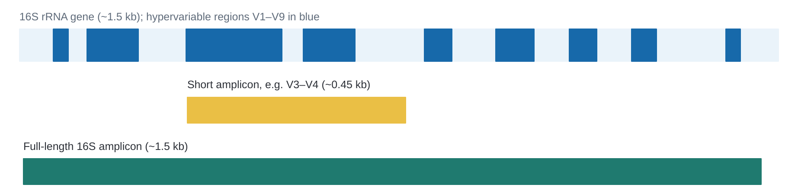
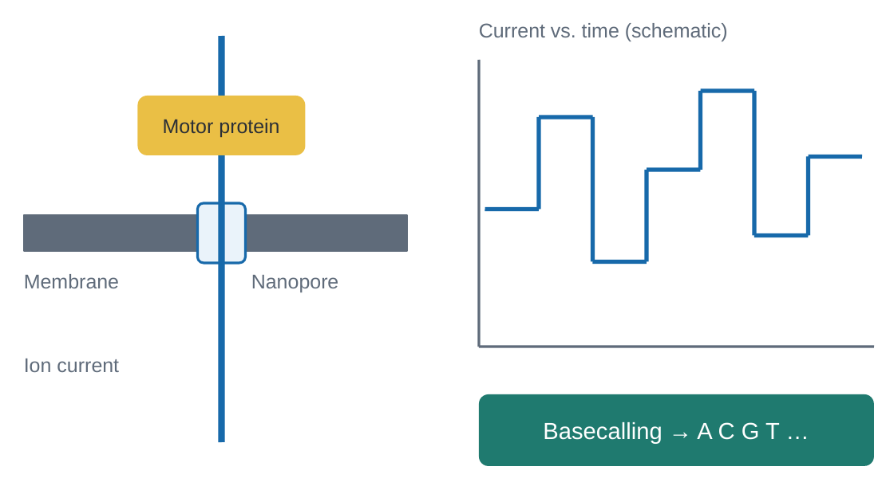
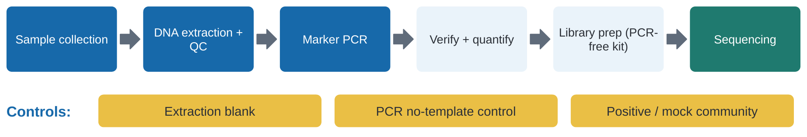
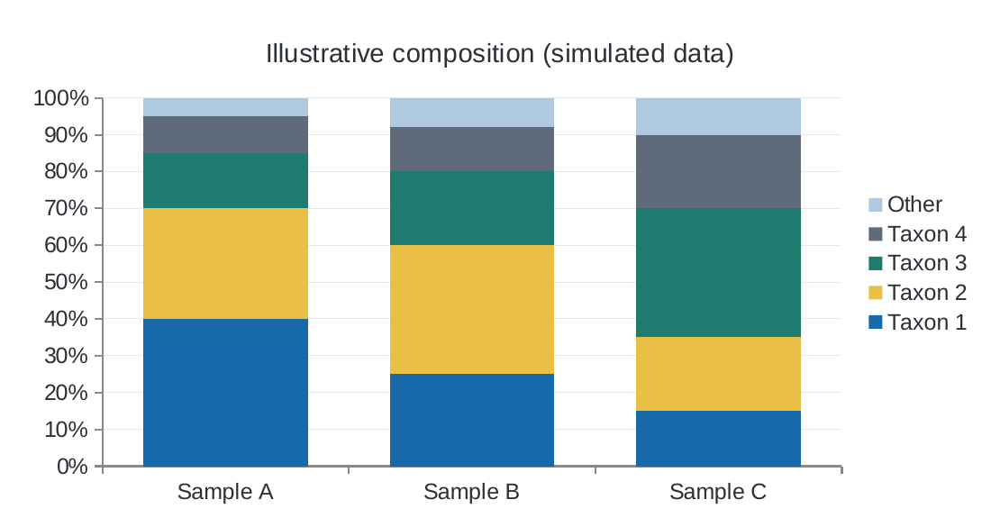

# ICONLITE Workshop 2026
## From Sample to Species: Amplicon Sequencing Using Oxford Nanopore Technology
### Companion Laboratory and Bioinformatics Handbook

**Native Barcoding Kit 24 V14 (`SQK-NBD114.24`) · PromethION · EPI2ME `wf-16s`**  
**Author / Institution:** [Presenter name, Institution – to be completed]  
**Version:** 1.0 (draft) · 8 November 2026  

> [!WARNING]
> **Educational companion.** The current Oxford Nanopore Technologies protocol remains the controlling reference for any actual laboratory work. For research use only.

---

## Table of Contents

- [About This Handbook](#about-this-handbook)
  - [How to Use It](#how-to-use-it)
  - [Learning Objectives](#learning-objectives)
  - [Scope and Safety](#scope-and-safety)
- [Part A – Scientific Foundations](#part-a--scientific-foundations)
  - [Chapter 1. Introduction and Learning Objectives](#chapter-1-introduction-and-learning-objectives)
  - [Chapter 2. Scientific Rationale](#chapter-2-scientific-rationale)
  - [Chapter 3. Sequencing Strategies](#chapter-3-sequencing-strategies)
  - [Chapter 4. Marker Selection and Primer Design](#chapter-4-marker-selection-and-primer-design)
  - [Chapter 5. Sequencing Platform Selection](#chapter-5-sequencing-platform-selection)
  - [Chapter 6. Nanopore Sequencing Principles](#chapter-6-nanopore-sequencing-principles)
  - [Chapter 7. ONT Instrumentation and Experimental Planning](#chapter-7-ont-instrumentation-and-experimental-planning)
- [Part B – ONT Laboratory Workflow](#part-b--ont-laboratory-workflow)
  - [Chapter 8. Laboratory Workflow Overview](#chapter-8-laboratory-workflow-overview)
  - [Chapter 9. H1–H8: Native Barcoding Kit V14 Guided Practical](#chapter-9-h1h8-native-barcoding-kit-v14-guided-practical)
    - [9.1 H1 · Preparing and Evaluating PCR Amplicons](#91-h1--preparing-and-evaluating-pcr-amplicons)
    - [9.2 H2 · End-Preparation: Preparing DNA for Ligation](#92-h2--end-preparation-preparing-dna-for-ligation)
    - [9.3 H3 · Native Barcode Ligation and Sample Multiplexing](#93-h3--native-barcode-ligation-and-sample-multiplexing)
    - [9.4 H4 · Sequencing Adapter Ligation and Final Library Clean-up](#94-h4--sequencing-adapter-ligation-and-final-library-clean-up)
    - [9.5 H5 · Priming and Loading the PromethION Flow Cell](#95-h5--priming-and-loading-the-promethion-flow-cell)
    - [9.6 H6 · MinKNOW Run Configuration and Data Generation](#96-h6--minknow-run-configuration-and-data-generation)
    - [9.7 H7 · From FASTQ to Biological Interpretation (`wf-16s` Walkthrough)](#97-h7--from-fastq-to-biological-interpretation-wf-16s-walkthrough)
    - [9.8 H8 · Mini Interactive Laboratory Exercise](#98-h8--mini-interactive-laboratory-exercise)
- [Part C – Bioinformatics](#part-c--bioinformatics)
  - [Chapter 10. Nanopore Data Formats and Basecalling](#chapter-10-nanopore-data-formats-and-basecalling)
  - [Chapter 11. Quality Control and Taxonomic Assignment](#chapter-11-quality-control-and-taxonomic-assignment)
  - [Chapter 12. Community Visualization and Interpretation](#chapter-12-community-visualization-and-interpretation)
- [Part D – Worked Research Case](#part-d--worked-research-case)
  - [Chapter 13. Case Study: Experimental Design, Results and Limits](#chapter-13-case-study-experimental-design-results-and-limits)
    - [13A Study Design and Data Generation](#13a-study-design-and-data-generation)
    - [13B Results and Interpretation](#13b-results-and-interpretation)
    - [How Alternative Decisions Might Change the Result](#how-alternative-decisions-might-change-the-result)
- [Part E – Critical Evaluation and Exercises](#part-e--critical-evaluation-and-exercises)
  - [Chapter 14. Limitations and Troubleshooting](#chapter-14-limitations-and-troubleshooting)
  - [Chapter 15. Summary, Exercises and Further Reading](#chapter-15-summary-exercises-and-further-reading)
- [Appendices](#appendices)
  - [Appendix A. Reagent and Consumables Checklist](#appendix-a-reagent-and-consumables-checklist)
  - [Appendix B. Barcode Assignment and Sample-Tracking Template](#appendix-b-barcode-assignment-and-sample-tracking-template)
  - [Appendix C. DNA Mass-to-Molarity Calculation Worksheet](#appendix-c-dna-mass-to-molarity-calculation-worksheet)
  - [Appendix D. Library Preparation Workflow Checklist](#appendix-d-library-preparation-workflow-checklist)
  - [Appendix E. Flow Cell Loading Checklist](#appendix-e-flow-cell-loading-checklist)
  - [Appendix F. FASTQ and Taxonomic Result Interpretation Guide](#appendix-f-fastq-and-taxonomic-result-interpretation-guide)
  - [Appendix G. Glossary](#appendix-g-glossary)
  - [Appendix H. References and Software/Version Register](#appendix-h-references-and-softwareversion-register)

---

## About This Handbook

This handbook accompanies the 23-slide workshop deck. It explains the science behind each slide and holds the operational detail that would overcrowd the slides: reaction tables, calculations, checkpoints, troubleshooting, worksheets and references. Slide identifiers map to chapters (Table 1), and H1–H8 keep their authoring labels.

### How to Use It

* **Foundational** boxes give an intuitive picture. **Advanced** boxes give mechanisms, parameters and caveats.
* Every chapter ends its slide mapping line with the slide numbers it supports.
* For each *“what is happening, why is it necessary, what could make the result unreliable”* question, the answer is in the chapter text.

#### Table 1. Source-status tags used throughout
| Tag | Meaning |
|---|---|
| **`[MFR]`** | Procedure or value stated in the manufacturer protocol (ONT `SQK-NBD114.24`, PromethION, rev. NBA_9168_v114_revU_15Jul2026) or in EPI2ME `wf-16s` documentation |
| **`[ADAPT]`** | A reasonable adaptation not stated by the manufacturer; confirm before relying on it |
| **`[EX]`** | Conceptual or hypothetical worked example; not experimental data |
| **`[LAB]`** | Laboratory-specific practice that depends on your equipment and habits |

### Learning Objectives

1. Distinguish DNA barcoding, metabarcoding and shotgun metagenomics.
2. Select molecular markers suited to different biological questions.
3. Explain nanopore sensing and distinguish long-read from short-read approaches.
4. Interpret PCR amplicon preparation, end-preparation, barcoding, pooling, adapter ligation and sequencing.
5. Relate POD5, basecalling, FASTQ, quality control, demultiplexing and taxonomic classification.
6. Read common QC plots and taxonomic community reports.
7. Identify analytical limitations, contamination risks and sources of erroneous conclusions.

### Scope and Safety

> [!WARNING]
> **Safety statement:** This handbook is an educational companion and a guided simulation, not a replacement for the current manufacturer protocol or your institution’s risk assessment. Follow local biosafety, chemical-handling and waste rules. Ethanol, EDTA and bead reagents need ordinary laboratory care; the protocol is for research use only.

#### Table 2. Slide-to-chapter map
| Slide | Chapter | Slide | Chapter |
|---|---|---|---|
| 1 | 1 Introduction | H1–H8 | 9.1–9.8 Hands-on block |
| 2 | 2 Scientific rationale | 9 | 10 Data formats and basecalling |
| 3 | 3 Sequencing strategies | 10 | 11 QC and taxonomic assignment |
| 4 | 4 Marker selection | 11 | 12 Community visualization |
| 5 | 5 Platform selection | 12 | 13A Case study: design and data |
| 6 | 6 Nanopore principles | 13 | 13B Case study: results |
| 7 | 7 ONT instrumentation | 14 | 14 Limitations and troubleshooting |
| 8 | 8 Laboratory workflow | 15 | 15 Summary and exercises |

---

## Part A – Scientific Foundations

### Chapter 1. Introduction and Learning Objectives
*Slides: 1*

A biological sample contains DNA from every organism that shed cells into it. Amplicon sequencing selects one genetic marker, copies it by PCR, reads the copies and compares them with reference sequences. The result is a list of organisms. The workshop follows a single sample from tube to taxonomic report and asks three questions at every step: **what is happening, why is it necessary, and what could make the result unreliable?**

> [!TIP]
> **Foundational:** Think of the marker as a name tag that every organism wears in a slightly different spelling. PCR photocopies the name tags, the sequencer reads them, and a database tells you whose tag it is.

> [!NOTE]
> **Advanced:** Every stage imposes a filter: extraction efficiency, primer coverage, PCR kinetics, library chemistry, basecalling accuracy, read filters, database completeness. The final table is the product of all of them, so conclusions must be phrased as “detected with this pipeline” rather than “present in nature”.

---

### Chapter 2. Scientific Rationale
*Slides: 2*

Culture-based methods report organisms that grow on the chosen medium under the chosen conditions. Many environmental microbes grow poorly or not at all in the laboratory, and morphology rarely resolves a mixed community. Targeted sequencing is culture-independent, scalable across many samples, and sensitive to rare taxa. It is used for water quality, soil and gut microbiomes, fungal surveys, and eDNA monitoring of animals (Taberlet et al. 2012).

#### Table 3. What each approach can and cannot tell you
| Approach | Answers | Misses |
|---|---|---|
| **Culture** | What grows, plus viable isolates for phenotype tests | Unculturable or slow organisms; medium bias |
| **Targeted molecular ID** | What an isolate or specimen is | Anything outside the marker’s primer reach |
| **Community profiling** | Which taxa a mixed sample contains | Viability, function, absolute abundance |

> [!NOTE]
> **Audience Question:** Can we identify all microorganisms in a water sample just by culturing them?  
> **Answer:** No. Culture reports what grows; amplicon sequencing reports which marker sequences were amplified. The two are complementary.

---

### Chapter 3. Sequencing Strategies
*Slides: 3*

#### Table 4. Three related strategies
| | DNA barcoding | DNA metabarcoding | Shotgun metagenomics |
|---|---|---|---|
| **Question** | What is this organism? | Who is in this mixed community? | Who is there and what genes do they carry? |
| **Input** | Single isolate or specimen | Mixed-community DNA | Mixed-community DNA |
| **Target** | One marker, PCR-amplified | Selected marker, PCR-amplified | All DNA, no marker-specific PCR |
| **Strength** | Simple, inexpensive | Many samples at low cost; deep on one marker | Broader content, gene function, strain-level work |
| **Limitation** | One organism per reaction | Primer bias; marker-limited resolution | Higher cost, more DNA, deeper sequencing, host DNA |

A practical rule: if you need to name an isolate, barcode it; if you need to compare who is present across many samples, metabarcode; if you need function or non-marker taxa (viruses, plasmids), consider shotgun. These workshop protocols address the first two.

---

### Chapter 4. Marker Selection and Primer Design
*Slides: 4*

#### Table 5. Common markers (values are typical orders of magnitude; confirm for your primer set)
| Marker | Target | Typical amplicon | Resolution and caveats |
|---|---|---|---|
| **16S rRNA** | Bacteria, Archaea | V-regions (hundreds of bp) or full-length ~1.5 kb | Nine hypervariable regions; copy number varies per genome; species calls depend on region and database (Johnson 2019) |
| **ITS1, ITS2, ITS1–ITS4** | Fungi | Length-variable (hundreds of bp) | Widely used fungal barcode; multi-copy; length variation biases PCR; alignment of divergent taxa is hard (Schoch 2012) |
| **18S rRNA** | Eukaryotes | Variable regions to near full-length | Broad coverage but species resolution is poor in many groups |
| **COI** | Animals | Barcode region ~0.66 kb | Strong species resolution in many animals; primer mismatch is common; not universal (Hebert 2003) |
| **12S rRNA (mitochondrial)** | Vertebrates, fish | Short: 163–185 bp for MiFish-U/E primers | Suits degraded eDNA; short target gives limited sequence for discrimination (Miya 2015) |

**Primer specificity and coverage.** Primers are chosen so that the target group is amplified and others are not. Degenerate bases widen coverage at the cost of specificity. **Fragment length** decides which platform and library chemistry are sensible (Chapters 5 and 9). **Resolution** depends on how variable the marker is among the taxa you care about and on whether the reference database contains them.

> [!NOTE]
> **Design note `[MFR]`:** For native barcoding, primers carry no adapter or barcode tails: barcodes are ligated later (Chapter 9.3). The EPI2ME `wf-16s` documentation lists `SQK-MAB114.24` (a PCR-based microbial amplicon barcoding kit) and `SQK-16S114.24` as its related protocols; this handbook follows the ligation route instead. Details of those alternative kits were not verified here.

> [!WARNING]
> No marker is universal across all taxa. Species discrimination depends on biology and reference-database characteristics.

---

### Chapter 5. Sequencing Platform Selection
*Slides: 5*

  
*Figure 1. Schematic 16S rRNA gene with hypervariable regions V1–V9 (blue), a V3–V4 amplicon and a full-length amplicon. Region boundaries approximate (E. coli numbering). Same figure as slide 5.*

Short-read platforms read short fragments with very high per-base accuracy, so short amplicons (for example V3–V4) are common. Nanopore reads can cover a complete marker such as full-length 16S in one read, carrying more informative sites that can improve species discrimination (Johnson et al. 2019). Longer targets are more fragile: degraded or fragmented environmental DNA often amplifies better with short amplicons.

#### Table 6. Trade-offs between short and long amplicon sequencing
| Factor | Short amplicon, short reads | Long amplicon, nanopore |
|---|---|---|
| **Informative sites** | Fewer | More (full-length marker) |
| **Per-base accuracy** | Very high | Improved with current chemistry; verify current ONT statements |
| **Fragmented eDNA** | Usually better | May fail for long targets |
| **Turnaround** | Batch-based | Real-time; run can be stopped when enough data exist |
| **Analysis** | Often denoising to variants | Read-level classification with error-aware tools |

---

### Chapter 6. Nanopore Sequencing Principles
*Slides: 6*

  
*Figure 2. Schematic of a nanopore in a membrane, motor protein, current trace and basecalling. Schematic only; not real signal. Same figure as slide 6.*

A protein nanopore sits in an electrically resistant membrane. A voltage drives ions through the pore, producing a measurable current. A motor protein attached to the adapter ratchets a single DNA strand through the pore at a controlled speed. As different stretches of bases pass through the narrowest part, they modulate the current in characteristic ways. Software, now a neural-network basecaller, converts the current-versus-time signal into bases in real time (Deamer et al. 2016).

> [!TIP]
> **Foundational:** Imagine pulling a ribbon with printed marks through a narrow keyhole while measuring how much light gets through. The pattern of brightness encodes the marks.

> [!NOTE]
> **Advanced:** The current at any instant reflects several nucleotides in the sensing region, not one, so there is no one-base-to-one-current-level mapping, and homopolymers and base modifications shape the signal. Basecalling accuracy depends on the chemistry, flow cell and model; DNA translocates at hundreds of bases per second in current chemistry. Do not draw trace pictures as if each step were a base.

*Further reading:* Deamer et al. 2016 (history); Jain et al. 2016 (MinION, with real current traces); Rang et al. 2018 (basecalling approaches); Wang et al. 2021 (current review). Full references are in Appendix H.

---

### Chapter 7. ONT Instrumentation and Experimental Planning
*Slides: 7*

#### Table 7. Platforms. Check ONT’s current device pages for specifications
| Platform | Scale | Flow cells | Typical use |
|---|---|---|---|
| **MinION** | Portable | 1 | Field work, pilot amplicon runs, teaching |
| **GridION** | Benchtop with onboard compute | Up to 5 in parallel | Routine multi-sample amplicon and genome runs |
| **PromethION** | High-throughput (24/48, 2 Solo, 2 Integrated variants) | Many, model-dependent | Large genomes; many barcoded amplicon pools |

Current ONT models include MinION Mk1D, GridION and GridION Q, PromethION 24/48, PromethION 2 Integrated and PromethION 2 Solo; ONT’s media-resources page lists press images for them, to be credited to Oxford Nanopore Technologies.

#### Planning an amplicon experiment
* **Samples per run:** the kit provides 24 barcodes, so up to 24 samples can share one flow cell `[MFR]`.
* **Replicates and controls:** reserve barcodes for the extraction blank, no-template control and a mock community.
* **Depth:** decide reads per sample from the expected richness and how rare the taxa you want to detect are; run a pilot first `[LAB]`.
* **Familiarize first:** the protocol strongly recommends a Lambda control experiment before real samples `[MFR]`.
* **Flow cell check:** do it within 12 weeks of purchase; the PromethION warranty minimum is 5,000 active pores `[MFR]`.
* **Compatibility:** this protocol is for R10.4.1 flow cells (`FLO-PRO114M`) only `[MFR]`.

---

## Part B – ONT Laboratory Workflow

### Chapter 8. Laboratory Workflow Overview
*Slides: 8*

  
*Figure 3. High-level laboratory workflow and controls. Same figure as slide 8.*

#### Sample collection and extraction
Collect with clean tools, record metadata (site, date, volume, preservation) and freeze or stabilize promptly. Extraction method decides which cells lyse and what carries over. Chemical contaminants, such as phenol, guanidine, ethanol or polysaccharides, can inhibit PCR and damage pores. The protocol’s QC guidance flags NanoDrop OD 260/280 below 1.8 and OD 260/230 below about 2.0–2.2 as signs of low purity `[MFR]`. Add a bead clean-up if needed. Reagent and laboratory contamination is common in low-biomass work, so negative controls are essential (Salter et al. 2014).

#### Marker PCR
Use a proofreading or high-fidelity polymerase where possible and the lowest cycle number that gives a clean product: more cycles raise chimera formation and amplification bias (Kebschull and Zador 2015). Verify a single band at the expected size on agarose gel before library prep.

#### Controls
#### Table 8. Controls and their purposes
| Control | Added at | What it tells you |
|---|---|---|
| **Extraction blank** | Extraction | Reagent and handling contamination (kit “kitome”) |
| **No-template PCR control** | PCR | Amplicon carry-over and primer-derived artifacts |
| **Positive / mock community** | Extraction or PCR | Primer bias, database errors, classification accuracy |
| **DNA Control Sample (DCS)** | End-prep | Library chemistry worked (troubleshooting) `[MFR]` |

> [!WARNING]
> **Important distinction:** “PCR-free” in the manufacturer’s description refers to the library preparation: there is no PCR during library prep. The input amplicons were made by PCR before library prep begins.

---

### Chapter 9. H1–H8: Native Barcoding Kit V14 Guided Practical

> [!NOTE]
> **Source Status `[MFR]`:** Procedures follow ONT, *“Ligation sequencing amplicons – Native Barcoding Kit 24 V14 (SQK-NBD114.24)”*, PromethION variant, rev. NBA_9168_v114_revU_15Jul2026 ([protocol reference link](https://nanoporetech.com/document/ligation-sequencing-amplicons-native-barcoding-v14-sqk-nbd114-24?device=PromethION)). In the 60-minute workshop this is a guided simulation. The PromethION page also contains some MinION/GridION content (for example the 800-pore warranty line and a 10–20 fmol loading remark); do not use those values for PromethION.

#### Table 9. Compatibility `[MFR]`
| Compatible item | Identifier |
|---|---|
| **Kit** | Native Barcoding Kit 24 V14, `SQK-NBD114.24` |
| **Flow cell** | R10.4.1, `FLO-PRO114M` |
| **Flow cell wash** | Flow Cell Wash Kit, `EXP-WSH004` |
| **Expansions** | Sequencing Auxiliary Vials V14 (`EXP-AUX003`); Native Barcoding Expansion V14 (`EXP-NBA114`) |
| **Devices** | PromethION 24/48, PromethION 2 Solo, PromethION 2 Integrated |

> [!WARNING]
> Do not mix barcoded with non-barcoded libraries before sequencing. The Native Adapter in this kit is not interchangeable with other sequencing adapters.

---

#### 9.1 H1 · Preparing and Evaluating PCR Amplicons

**Objective.** Decide whether an amplicon is suitable and compute the molar input.  
**Principle.** Ligation reactions act on molecules, not on nanograms. A 500 bp and a 1,500 bp fragment at equal mass differ threefold in molecule count.

**Equipment and consumables.** Gel electrophoresis system, Qubit fluorometer with dsDNA HS assay (Q32851) and assay tubes (Q32856), nuclease-free water, optional NanoDrop `[MFR]`.

1. Run 1–5 µL of each PCR product on an agarose gel with a ladder. Expect one sharp band at the target size.
2. Remove primer-dimers and nonspecific products (bead clean-up or gel extraction) if present `[ADAPT]`.
3. Quantify with Qubit dsDNA HS; do not rely on A260 for amplicons.
4. Convert to fmol and calculate the volume for 200 fmol per sample `[MFR: 200 fmol, equal to 130 ng for 1 kb]`.

> [!TIP]
> **Formula:**  
> $$\text{mass (ng)} \approx \frac{\text{fmol} \times \text{length (bp)} \times 660}{1{,}000{,}000}$$  
> For 200 fmol of a 1,500 bp amplicon:  
> $$\text{mass} \approx \frac{200 \times 1{,}500 \times 660}{10^6} \approx \mathbf{198\text{ ng}}$$

#### Table 10. Equal mass is not equal molarity `[EX]`
| Length | 200 fmol equals | 130 ng equals |
|---|---|---|
| **500 bp** | 66 ng | ≈394 fmol |
| **800 bp** | 105.6 ng | ≈246 fmol |
| **1,500 bp** | 198 ng | ≈131 fmol |

> [!NOTE]
> **Worked example:** A 1,500 bp amplicon at 40 ng/µL: 198 ng needs 4.95 µL, so add 6.55 µL nuclease-free water to reach 11.5 µL; the DNA Control Sample is a separate 1 µL in the 15 µL mix (see H2) `[EX]`. If the needed volume exceeds 11.5 µL the product is too dilute; concentrate it or lower the input `[ADAPT]`.

> *[Placeholder: Insert real agarose gel photograph from the presenter’s lab]*  
> *Figure: Gel of PCR amplicons (to be added; no simulated lanes)*

**QC checkpoints.** Single band at expected size; concentration measured by Qubit; no-template control clean.  
**Troubleshooting.** Smear: too many cycles or degraded template. Extra band: nonspecific priming; optimize annealing. Low yield: inhibitors or low template; clean up and re-amplify. Purity: see Chapter 8.  
**Official reference:** protocol sections 1–3 (Overview, Equipment, End-prep). A reusable worksheet is Appendix C.

---

#### 9.2 H2 · End-Preparation: Preparing DNA for Ligation

**Objective and principle.** End-prep repairs ragged ends and adds a 3′ dA-tail so downstream ligations can attach barcodes and adapters. This follows the function of the NEBNext Ultra II End Repair/dA-Tailing module; the protocol describes the step as preparing DNA ends for adapter attachment.

**Equipment.** Thermal cycler, magnetic rack, Hula (rotator) mixer, 0.2 mL tubes or plate, DNA LoBind tubes, freshly prepared 80% ethanol.  
**Reagents.** NEBNext Ultra II End Repair/dA-Tailing Module (E7546), AMPure XP Beads (AXP), DNA Control Sample (DCS).

#### Table 11. End-prep reaction `[MFR]`
| Reagent (per sample) | Volume |
|---|---|
| Amplicon DNA (200 fmol; 130 ng for 1 kb) | 11.5 µL |
| Diluted DNA Control Sample (DCS) | 1 µL |
| Ultra II End-prep Reaction Buffer | 1.75 µL |
| Ultra II End-prep Enzyme Mix | 0.75 µL |
| **Total** | **15 µL** |

1. Thaw AXP and DCS at room temperature; vortex. Dilute DCS: add 105 µL Elution Buffer (EB) to one DCS tube (enough for 140 samples).
2. Make up each sample to 11.5 µL with nuclease-free water. Add components in order; pipette-mix 10–20 times between additions. A master mix (2.5 µL per well of buffer plus enzyme) is recommended.
3. Incubate in a thermal cycler: **20 °C for 5 min, then 65 °C for 5 min**.
4. Transfer to a clean 1.5 mL LoBind tube, add 15 µL resuspended AXP, mix by flicking, rotate 5 min at room temperature.
5. Pellet on a magnet; discard supernatant; wash twice with 200 µL fresh 80% ethanol; remove residual ethanol; dry about 30 s without cracking.
6. Resuspend in 10 µL nuclease-free water, 2 min at room temperature, pellet, keep the 10 µL eluate.
7. Quantify 1 µL by Qubit. Optional stop: 4 °C overnight.

> [!WARNING]
> Do not vortex the Ultra II End Prep Enzyme Mix. Mix the reaction buffer well; vortex at least 30 s if a white precipitate persists. Ethanol below 70% elutes DNA from beads.

> [!NOTE]
> **Optional control `[MFR]`:** The DCS (a 3.6 kb standard amplicon from the 3′ end of the Lambda genome) is recommended for troubleshooting but may be omitted, replacing its 1 µL with sample DNA. It is optional, not mandatory.

> [!IMPORTANT]
> **Gap to close `[ADAPT]`:** The protocol says to carry forward an “equimolar” amount of each sample into barcoding but, in the text consulted, does not state a target fmol for the 7.5 µL that enters ligation, and conflates mass with molarity. A common practice is to normalize each eluate to the same molar concentration (or the same ng/µL for amplicons of identical length) so that 7.5 µL contains equal fmol `[ADAPT]`. Confirm against the protocol figures or ONT support.

**QC checkpoints.** Qubit yield recorded for every sample.  
**Troubleshooting.** Low recovery after end-prep: wash ethanol below 70%, or beads not resuspended.  
**Official reference:** protocol section 3.

---

#### 9.3 H3 · Native Barcode Ligation and Sample Multiplexing

**Objective and principle.** Each sample receives a unique native barcode, a short DNA sequence ligated to both ends, so many samples can be pooled and later separated by software (demultiplexing).

#### Table 12. Barcode ligation `[MFR]`
| Reagent (per sample) | Volume |
|---|---|
| End-prepped DNA | 7.5 µL |
| Native Barcode (NB01–24) | 2.5 µL |
| Blunt/TA Ligase Master Mix | 10 µL |
| **Total** | **20 µL** |

1. Thaw the ligase mix, EDTA, Short Fragment Buffer (SFB) and barcodes; mix each, ligase by ten full-volume pipette mixes.
2. Choose a **unique barcode per sample** in one experiment; the barcode well is single-use. Record the assignment first (Appendix B).
3. Add end-prepped DNA, barcode and ligase mix in that order, pipette-mixing 10–20 times; spin down.
4. Incubate **20 min at room temperature**; add **4 µL EDTA** to stop; mix.
5. Pool all reactions in one 1.5 mL LoBind tube.
6. Add **0.4× AXP** (volume below), rotate 10 min at room temperature, pellet 5 min.
7. Wash twice with **700 µL SFB** (flick to resuspend, pellet, discard); remove residual buffer.
8. Resuspend in 35 µL nuclease-free water, 10 min at 37 °C flicking every 2 min for 10 s; pellet; keep 35 µL; Qubit 1 µL. Optional stop: 4 °C overnight.

#### Table 13. Pooling arithmetic `[MFR]`
| | Per sample | 6 samples | 12 samples | 24 samples |
|---|---|---|---|---|
| **Pool volume (with EDTA)** | 24 µL | 144 µL | 288 µL | 576 µL |
| **AXP at 0.4×** | ≈9.6 µL | 58 µL | 115 µL | 230 µL |

> [!WARNING]
> Each sample needs its own barcode and sample identity must be tracked before pooling. Check that all tubes hold the same volume before and after pooling to confirm nothing was missed.

> [!NOTE]
> **Examples of barcode misassignment `[EX]`:** Two samples given the same barcode cannot be separated after pooling; a swapped tube or well label assigns reads to the wrong sample; a reused or reopened barcode well may carry contamination. All are hypothetical illustrations.

> [!IMPORTANT]
> **Short amplicons `[MFR]`:** The protocol’s troubleshooting notes that bead-to-sample ratios below 0.4:1 lose DNA of any size, and that lower ratios select more strongly against short fragments; measure amplicon length by gel and compute the ratio accordingly. A 0.4× cleanup suits ~1.5 kb amplicons but would substantially deplete short amplicons such as ~170 bp 12S products.

**Official reference:** protocol section 4.

---

#### 9.4 H4 · Sequencing Adapter Ligation and Final Library Clean-up

**Objective and principle.** Barcodes identify samples; the **Native Adapter** (NA) carries the motor protein that lets a DNA molecule engage the pore. They are different parts of the library.

#### Table 14. Adapter ligation `[MFR]`
| Reagent | Volume |
|---|---|
| Pooled barcoded DNA | 30 µL |
| Native Adapter (NA) | 5 µL |
| NEBNext Quick Ligation Reaction Buffer (5×) | 10 µL |
| Quick T4 DNA Ligase | 5 µL |
| **Total** | **50 µL** |

1. Do not vortex the Quick T4 DNA Ligase; mix reagents by pipetting. Thaw EB; keep LFB or SFB at room temperature.
2. Mix the reaction in the order shown; incubate **20 min at room temperature**.
3. Add 20 µL resuspended AXP, rotate 10 min, pellet.
4. Wash twice with **125 µL LFB or SFB** (never ethanol).
5. Briefly dry (~30 s), resuspend in 25 µL EB, 10 min at 37 °C flicking every 2 min, pellet at least 1 min, keep 25 µL. Qubit 1 µL.

#### Table 15. Critical decision point `[MFR]`
| Wash buffer | Effect | Use for |
|---|---|---|
| **Short Fragment Buffer (SFB)** | Retains fragments of all sizes | Amplicons around 1.5 kb and shorter |
| **Long Fragment Buffer (LFB)** | Enriches fragments of about 3 kb and above | Genomic libraries where short fragments are unwanted |

> [!WARNING]
> Ethanol after adapter ligation denatures the motor protein and drives pore occupancy toward zero. Use SFB for the ~1.5 kb bacterial 16S workflow because LFB would deplete it.

#### Table 16. Final library loading amount, prepared in 32 µL EB `[MFR]`
| Library length | Flow cell loading |
|---|---|
| **Very short (<1 kb)** | 100 fmol |
| **Short (1–10 kb)** | 35–50 fmol |
| **Long (>10 kb)** | 300 ng |

> [!NOTE]
> **Worked example `[EX]`:** 40 fmol of a 1,500 bp library:  
> $$40 \times 1{,}500 \times \frac{660}{10^6} \approx 39.6\text{ ng}$$  
> So the 32 µL load needs about 1.24 ng/µL. If the library yield is below the recommendation, load the entire library.

Store libraries in LoBind tubes at 4 °C short-term or −80 °C for more than 3 months. A library may be diluted in EB to split across flow cells.  
**Official reference:** protocol section 5.

---

#### 9.5 H5 · Priming and Loading the PromethION Flow Cell

**Objective.** Identify the critical physical steps.  
**Equipment.** PromethION device, PromethION Flow Cell Light Shield, P1000, P200 and P20 pipettes.  
**Reagents.** Sequencing Buffer (SB), Library Beads (LIB) or Library Solution (LIS), Flow Cell Tether (FCT), Flow Cell Flush (FCF).

#### Table 17. Priming mix `[MFR]`
| Reagent | Volume |
|---|---|
| Flow Cell Flush (FCF) | 1,170 µL |
| Flow Cell Tether (FCT) | 30 µL |
| **Total** | **1,200 µL** |

#### Table 18. Library loading mix `[MFR]`
| Reagent | Volume |
|---|---|
| Sequencing Buffer (SB) | 100 µL |
| Library Beads (thoroughly mixed) or Library Solution | 68 µL |
| DNA library | 32 µL |
| **Total** | **200 µL** |

1. Bring the flow cell to room temperature for 20 min; wipe condensation from the gold pins; confirm the black heat pad is present.
2. Thaw and vortex SB, LIB or LIS, FCT and FCF; prepare the priming mix.
3. Insert the flow cell (PromethION 24/48: align, insert smoothly, press until the latch clicks; P2 Solo: slide until pins are hidden). A wrong angle damages the pins.
4. Run a flow cell check unless done earlier.
5. Slide the inlet port cover clockwise. Set a P1000 to 200 µL, insert and draw back only until a small volume enters the tip (do not remove more than 20–30 µL) to clear the bubble.
6. Load **500 µL** priming mix slowly; wait **5 min** and prepare the library mix, mixing LIB immediately beforehand (beads settle quickly).
7. Load the second **500 µL** of priming mix; mix the library gently; load **200 µL**; close the valve.
8. Fit the light shield and close the lid. Wait at least 10 min before starting a run.

#### Table 19. Failure modes `[MFR]`
| Risk | Consequence | Prevention |
|---|---|---|
| **Air bubble in array** | Irreversible pore loss | Draw back small volume; slow loading |
| **Skipped tether** | Pore occupancy near 0 | Add FCT to FCF every time |
| **Unmixed Library Beads** | Poor loading | Mix immediately before use |
| **Ethanol wash after adapters** | Pore occupancy near 0 | Use SFB/LFB |
| **Under-loaded library** | Pore occupancy below 40% | Quantify and load recommended amount |
| **Wrong insertion angle** | Damaged device pins | Align, insert smoothly |

> *[Placeholder: Insert photographs of the PromethION flow cell, inlet port and priming sequence from the presenter’s lab]*  
> *Figure: Flow cell and inlet-port photographs (to be added)*

Use the PromethION procedure only; the MinION/GridION variant has different volumes.  
**Official reference:** protocol section 6.

---

#### 9.6 H6 · MinKNOW Run Configuration and Data Generation

**Objective.** Move from the bench to digital data. MinKNOW controls the device, acquires raw data and basecalls in real time.

1. Open the **Start** page and click **Start Sequencing**. In the **Positions** tab enter the experiment name and sample ID and confirm the flow cell type (`FLO-PRO114M`); then **Continue to kit selection**.
2. Select **Native Barcoding Kit 24 V14 (`SQK-NBD114.24`)**. MinKNOW can then split reads by barcode without command-line tools; continue to run options.
3. In **Run options** set the run length and minimum read length, or keep the defaults. Adaptive sampling is not needed for amplicons. Continue to analysis.
4. In **Analysis** confirm basecalling and barcoding. One independent SOP (CC BY, for the 96-barcode kit) uses high-accuracy basecalling with barcode trimming and mid-read barcode filtering `[LAB]`; choose settings deliberately and record them.
5. In **Output** choose the data location and formats (POD5 for raw reads, FASTQ for basecalled reads) and keep or set the filter score; continue to the final review.
6. Review the run set-up page and click **Start**. MinKNOW then shows run statistics, flow cell health and channel states.

> [!NOTE]
> **Source `[MFR]`:** Step wording follows ONT’s *Experiment Companion – MinKNOW* and the *MinKNOW Technical Document* (`MITD_5000_v1_revAK_25Nov2024`); menu labels change with MinKNOW version.

#### Table 20. Run configuration checklist `[LAB]`
| Record for reproducibility | Example |
|---|---|
| **MinKNOW and basecaller versions, model** | Fill in from the run |
| **Flow cell ID, kit, position** | Fill in from the run |
| **Basecalling mode, minimum Q filter** | Fill in from the run |
| **Output formats** | POD5 and FASTQ |
| **Run duration and final yield** | Fill in from the run |

MinKNOW typically writes POD5 raw files and FASTQ files, and with demultiplexing enabled sorts FASTQ into per-barcode folders (for example `barcode01`); exact folder names vary with MinKNOW version, so check yours.  
> *[Placeholder: Insert annotated MinKNOW screenshots captured from a real run]*  
> *Figure: MinKNOW run set-up and yield screens (to be added)*

**Official reference:** protocol section 7 and the MinKNOW protocol.

---

#### 9.7 H7 · From FASTQ to Biological Interpretation (`wf-16s` Walkthrough)

**Objective.** Run a compact analysis on a completed run. EPI2ME `wf-16s` classifies 16S, 18S and ITS amplicons with either **minimap2** (alignment, the default) or **Kraken2 + Bracken** (k-mer matching). Source: EPI2ME `wf-16s` documentation `[MFR]`.

#### GUI walkthrough (EPI2ME Desktop)
1. Install EPI2ME Desktop and its container engine; open the `wf-16s` workflow.
2. Select the FASTQ input folder (the folder holding one sub-folder per barcode) and a sample sheet CSV with columns `barcode` and `alias`.
3. Choose the classifier and database; for full-length 16S keep the defaults.
4. For ITS lower `min_len` to 300 and set `database_set` to `ncbi_16s_18s_28s_ITS`.
5. Start the run; open `wf-16s-report.html` when it finishes.

> *[Placeholder: Insert real wf-16s report screenshots]*  
> *Figure: wf-16s report: read statistics, abundance table, bar plot (to be added)*

#### Table 21. Key wf-16s parameters `[MFR]`
| Parameter | Default | Meaning |
|---|---|---|
| `classifier` | `minimap2` | minimap2 or kraken2 |
| `database_set` | `ncbi_16s_18s` | also `ncbi_16s_18s_28s_ITS`, `SILVA_138_1` |
| `min_len` / `max_len` | `800 / 2000` | Read-length window (bp) |
| `min_percent_identity` | `95` | minimap2 identity needed to classify |
| `min_ref_coverage` | `90` | minimap2 reference coverage needed |
| `taxonomic_rank` | `G` (genus) | Rank for tables and diversity |
| `abundance_threshold` | `1` | Drop taxa at or below this count |
| `n_taxa_barplot` | `9` | Taxa shown before “Other” |
| `kraken2_confidence` | `0.0` | Kraken2 confidence threshold |
| `bracken_threshold` | `10` | Minimum reads for Bracken |

#### Optional command line
```bash
nextflow run epi2me-labs/wf-16s \
  --fastq <folder> \
  --sample_sheet samples.csv \
  --out_dir output \
  -profile standard
```
The documented demo is:
```bash
nextflow run epi2me-labs/wf-16s \
  --fastq wf-16s-demo/test_data \
  --minimap2_by_reference \
  -profile standard
```
Recommended resources: 12 CPUs and 32 GB RAM (minimum 6 CPUs, 16 GB); about 40 min for 1 million reads over 24 barcodes with minimap2 and the `ncbi_16s_18s` database.

Use a completed run during the workshop rather than live sequencing and analysis.  
**Reference:** `wf-16s` documentation (https://epi2me.nanoporetech.com/epi2me-docs/workflows/wf-16s/).

---

#### 9.8 H8 · Mini Interactive Laboratory Exercise

Five scenario-based questions reinforce the decisions made in H1–H7. Deliver by show of hands, printed worksheet or polling software. Answers, explanations and protocol references are in Chapter 15.

1. What DNA mass is needed for 200 fmol of an amplicon of a stated length?
2. Assign unique barcodes to six biological samples.
3. Is SFB or LFB appropriate for a 1.5 kb amplicon?
4. What is the correct final PromethION loading volume?
5. What is the most likely effect of one stated laboratory mistake?

---

## Part C – Bioinformatics

### Chapter 10. Nanopore Data Formats and Basecalling
*Slides: 9*

Raw acquisition produces ionic-current measurements, stored in **POD5** files. A basecaller (Dorado, run inside MinKNOW or separately) converts signal to bases and attaches a per-base quality, giving **FASTQ**. Demultiplexing reads the barcode sequences at read ends and sorts reads into per-sample files. Basecalling and demultiplexing yield reads and sample labels, not species; taxonomy comes later (Chapter 11).

#### Table 22. Data files
| File | Holds | Keep? |
|---|---|---|
| **POD5** | Raw signal; allows re-basecalling with newer models | Yes, as the archive of record |
| **FASTQ(.gz)** | Bases and per-base Phred quality, per barcode | Yes; input to analysis |
| **Sample sheet CSV** | Barcode-to-sample mapping (`barcode`, `alias`) | Yes; part of the metadata |
| **Report and tables** | `wf-16s` outputs | Yes; with versions and parameters |

#### Anatomy of a FASTQ record
A record has four lines:
1. Identifier line starting with `@` (read ID and run metadata)
2. Base sequence
3. `+` separator line
4. Quality string with one Phred+33 character per base

$$\text{Phred } Q = -10 \cdot \log_{10}(P_{\text{error}})$$

#### Table 23. Phred scores
| Q Score | Error probability | Accuracy |
|---|---|---|
| **10** | 1 in 10 | 90% |
| **20** | 1 in 100 | 99% |
| **30** | 1 in 1,000 | 99.9% |

> [!NOTE]
> **Advanced:** Basecalling models trade speed for accuracy; the chosen model, its version and any minimum-quality filter belong in the run record (Appendix H). A basecalling or classification result cannot be reproduced without them.
>
> **Metadata to keep:** sample IDs, barcode map, primer set, kit and flow cell IDs, software and model versions, database versions, parameters.

---

### Chapter 11. Quality Control and Taxonomic Assignment
*Slides: 10*

#### Read QC
Inspect the read-length distribution first. A clean amplicon library shows a dominant peak at the expected size (about 1.5 kb for full-length 16S). Shoulders and tails can mean chimeras, nonspecific products, primer-dimers or fragmented input. Check the quality distribution and the number of reads per barcode; a barcode with few reads cannot be interpreted. Filter by length and quality (`min_len`, `max_len`, `min_read_qual` in `wf-16s`; defaults for length are 800–2,000 bp). Primer remnants and off-target sequences should be examined, not silently discarded.

#### Two classification approaches
#### Table 24. Alignment versus k-mer classification `[MFR]`
| | Alignment (minimap2; Li 2018) | k-mer matching (Kraken2, Wood 2019; Bracken, Lu 2017) |
|---|---|---|
| **Principle** | Align each read to references; keep hits above identity and coverage thresholds | Match read k-mers to a taxon index; Bracken re-estimates abundance at a rank |
| **Strength** | Finer resolution, per ONT documentation | Fastest |
| **Watch out** | Slower on large databases; thresholds set what is “unclassified” | Confidence threshold and database content drive calls |
| **Key defaults** | 95% identity, 90% coverage | Confidence 0.0; Bracken threshold 10 |

#### Reference databases
#### Table 25. wf-16s databases `[MFR]`
| Database | Content | Note |
|---|---|---|
| **`ncbi_16s_18s` (default)** | Archaeal, bacterial and fungal 16S/18S rDNA (NCBI targeted loci; see O’Leary 2016) | Taxonomy snapshot dated 2025-01-01 |
| **`ncbi_16s_18s_28s_ITS`** | Adds 28S and ITS | Needed for ITS amplicons |
| **`SILVA_138_1`** | SSU rRNA, Bacteria, Archaea, Eukarya | SILVA (Quast 2013); genus is the lowest rank; own taxids |
| **`Greengenes2_plus`** | Greengenes2 2024.09 with additions | Custom taxonomy |
| **`Standard-8`, `PlusPF-8`, `PlusPFP-8`** | Kraken2 whole-genome indexes capped at 8 GB | Kraken2 only; not marker-specific |

> [!WARNING]
> A taxon absent from the reference cannot be assigned correctly; it will be unclassified or misassigned to a relative. Taxonomy snapshots age: names change after a database is built.

#### Parameter sensitivity
#### Table 26. How analysis choices change the table
| Decision | Effect on results |
|---|---|
| **Lower identity or coverage threshold** | More reads classified, more false assignments |
| **Higher threshold** | Cleaner calls, more “Unknown” |
| **Length window** | Defaults drop short amplicons such as ITS or 12S |
| **Taxonomic rank (genus vs species)** | Species rank over-claims where markers cannot discriminate |
| **Database choice** | Changes names, rank resolution and unclassified fraction |
| **`abundance_threshold`** | Hides or reveals rare taxa; interacts with contamination |

---

### Chapter 12. Community Visualization and Interpretation
*Slides: 11*

  
*Figure 4. Illustrative stacked bar plot with simulated values. Not experimental data. Same figure as slide 11.*

An **abundance table** lists reads per taxon per sample. A **stacked bar plot** shows relative composition; `wf-16s` groups all but the top taxa under “Other”. **Sankey and sunburst plots** show lineages from domain to genus. **Alpha diversity** summarizes one sample; **beta diversity** compares samples. `wf-16s` reports alpha-diversity metrics and a rarefaction curve; beta diversity needs additional analysis.

#### Table 27. Diversity indices (wf-16s)
| Metric | Meaning |
|---|---|
| **Richness** | Number of distinct taxa |
| **Shannon $H = -\sum p_i \ln p_i$** | Near 0 if one taxon dominates |
| **Simpson $D = \sum p_i^2$** | As defined in the `wf-16s` documentation |
| **Pielou $J = H / \ln S$** | 0 = dominated, 1 = perfectly even |
| **Berger–Parker** | Share of the most abundant taxon |
| **Fisher’s alpha** | Models the many-rare-taxa pattern |

`wf-16s` computes indices from the original abundance table by default and offers a rarefied table, subsampled to 95% of the smallest library; all “Unknown” reads are counted as one taxon, so a high unclassified fraction distorts indices. Rarefying is contested: McMurdie and Holmes (2014) show it can discard information and inflate false positives in differential-abundance tests, and Gloor et al. (2017) argue that microbiome count data should be analyzed as compositions.

> [!WARNING]
> **Audience Question:** Relative abundance is not population size. If taxon A yields twice the reads of taxon B, you cannot conclude twice as many cells: 16S copy number differs between genomes, extraction and PCR favour some taxa, and proportions sum to 100% so one taxon rising lowers the others.

---

## Part D – Worked Research Case

### Chapter 13. Case Study: Experimental Design, Results and Limits
*Slides: 12–13*

> [!NOTE]
> **Status:** This chapter is a template. The presenter will supply a completed ONT bacterial 16S or fungal ITS project with authorized data. No sample descriptions, statistics or data files have been invented. Remove confidential identifiers and obtain permission before sharing.

#### 13A Study Design and Data Generation

#### Table 28. Case-study design record
| Item | Entry (presenter to complete) |
|---|---|
| **Research objective** | |
| **Samples and comparison groups** | |
| **Metadata (site, date, preservation)** | |
| **Marker, primers, amplicon size** | |
| **Extraction and PCR conditions** | |
| **Library kit and platform** | |
| **Run settings and software versions** | |
| **Yield (reads, bases) and per-barcode counts** | |
| **Read-length distribution and quality summary** | |
| **Controls included and their results** | |

> *[Placeholder: Insert two real QC plots: read-length distribution and quality summary]*  
> *Figure: Case-study QC plots (to be added)*

#### 13B Results and Interpretation

#### Table 29. Case-study results record
| Item | Entry (presenter to complete) |
|---|---|
| **Classification method, database and parameters** | |
| **Taxonomic composition (top taxa, table)** | |
| **Differences between samples, where supported** | |
| **Unclassified or ambiguous reads (fraction and handling)** | |
| **Three evidence-based findings with supporting numbers** | |
| **Limitations and follow-up experiments** | |

> *[Placeholder: Insert real stacked bar plot and taxonomic summary table]*  
> *Figure: Case-study composition and taxa table (to be added)*

> [!WARNING]
> Distinguish detection from proof of organism viability, environmental origin or absolute abundance. Every conclusion should cite a number in the table above.

#### How Alternative Decisions Might Change the Result
#### Table 30. Sensitivity checks to run on the case study
| Alternative decision | Likely consequence to check |
|---|---|
| **Switch classifier (minimap2 vs Kraken2)** | Different unclassified fraction and genus-level counts |
| **Change identity or coverage threshold** | Taxa appear or disappear near the cut-off |
| **Use a different database or snapshot** | Different names and resolution |
| **Report species instead of genus** | Over-claiming where markers cannot discriminate |
| **Subtract taxa seen in blanks** | Removes likely contaminants; may also remove true rare taxa |

**Traceability.** Each figure and finding should link to a raw data file, a parameter set and a software version listed in Appendix H.

---

## Part E – Critical Evaluation and Exercises

### Chapter 14. Limitations and Troubleshooting
*Slides: 14*

#### Table 31. Benefits versus limitations
| Strengths | Limitations and pitfalls |
|---|---|
| Real-time data; stop when enough | PCR primer bias and artifacts (chimeras, uneven amplification) |
| Long reads possible, full-length markers | Contamination from reagents and handling |
| Portable to high-throughput | Barcode misassignment and cross-talk |
| Barcoding multiplexes up to 24 samples | Marker limits and reference-database quality |
| Culture-independent | Read counts are not organism abundance; detection is not confirmation |

#### Troubleshooting guide
#### Table 32. Symptom–cause–action table
| Observation | Likely cause | Action | Basis |
|---|---|---|---|
| **Low DNA recovery after bead clean-up** | Bead ratio below 0.4:1, short fragments, beads not resuspended, ethanol <70% | Resuspend beads; check fragment length on gel and compute the ratio; use 80% ethanol | `[MFR]` |
| **Pore occupancy below 40%** | Too little library loaded | Quantify the library; load the recommended amount | `[MFR]` |
| **Pore occupancy near 0** | Ethanol used after adapter ligation, or tether omitted | Use LFB/SFB; add FCT to FCF | `[MFR]` |
| **Fewer pores than flow cell check** | Air bubble, poor insertion, contaminants | Remove bubbles; reseat; clean DNA | `[MFR]` |
| **Many unavailable or inactive pores** | Contaminants or air bubbles | Re-purify; nuclease flush (`EXP-WSH004`) | `[MFR]` |
| **Shorter reads than expected** | Fragmented input; harsh mixing | Check gel; flick or invert instead of vortexing | `[MFR]` |
| **Reads in the negative control** | Reagent contamination or barcode crossover | Flag and filter by the control; review pooling and well handling | `[ADAPT]` |
| **Many unclassified reads** | Reference gap, thresholds, off-target reads | Examine unclassified FASTQ; try another database | `[ADAPT]` |

> [!NOTE]
> **Advanced:** Interpret rare taxa against the blanks. A taxon in both samples and controls at similar abundance is a contaminant until shown otherwise. Species-level claims need a marker and database able to resolve that species.

---

### Chapter 15. Summary, Exercises and Further Reading
*Slides: 15*

#### Four Closing Messages
1. Amplicon sequencing targets selected genetic markers.
2. Marker, primer and platform selection set the scope of the findings.
3. Laboratory preparation and computational processing both influence data quality.
4. Taxonomic assignments require biological context and critical interpretation.

#### H8 Answer Key
#### Table 33. H8 answers
| Q | Answer | Explanation and reference |
|---|---|---|
| **1** | Example: 800 bp → $200 \times 800 \times \frac{660}{10^6} \approx 106\text{ ng}$ | $\text{mass} = \text{fmol} \times \text{bp} \times \frac{660}{10^6}$; protocol input 200 fmol (§2–3) |
| **2** | Any six distinct barcodes, e.g. NB01–NB06, logged before pooling | One unique barcode per sample, up to 24 (§4) |
| **3** | SFB | LFB enriches ≥ ~3 kb and would deplete a 1.5 kb library (§5) |
| **4** | 200 µL (100 SB + 68 LIB/LIS + 32 library) | PromethION loading mix (§6); MinION/GridION differs |
| **5** | Example: ethanol wash after adapter ligation → pore occupancy near 0 | Use LFB/SFB, not ethanol (§5; troubleshooting §11) |

#### Review Questions and Answers
#### Table 34. Review questions and answers
| # | Question | Answer |
|---|---|---|
| **1** | Why can equal masses of two amplicons be unequal in molecules? | Molecules scale inversely with length: shorter fragments have more molecules per ng. |
| **2** | Which step makes the library “PCR-free”, and which step is PCR? | The kit has no PCR during library prep; marker PCR happens before it. |
| **3** | Why is a negative control essential even with barcoded multiplexing? | Barcodes do not remove reagent contamination; the control reveals it. |
| **4** | Name two reasons read counts do not equal cell numbers. | Copy-number variation, PCR and extraction bias, compositional data. |
| **5** | What changes if the target amplicon is 170 bp instead of 1.5 kb? | Bead ratios, read-length filters and reference database all need adapting; `wf-16s` defaults do not fit. |
| **6** | What do the `min_len` and `database_set` defaults assume? | Full-length 16S reads and an rRNA reference of bacteria, archaea and fungi. |

#### Closing Synthesis: Connecting to Fish eDNA Metabarcoding
Fish eDNA typically uses a short mitochondrial 12S target. Reapplying the same workflow means revisiting several decisions rather than copying settings.

#### Table 35. What changes for fish eDNA `[ADAPT]`
| Decision | Full-length 16S workflow | Short 12S eDNA |
|---|---|---|
| **Bead ratio (pooled cleanup)** | 0.4× (~1.5 kb) | Must be re-derived from amplicon size |
| **Final library load** | 35–50 fmol (1–10 kb) | Possibly the <1 kb row (100 fmol) |
| **`wf-16s` length window** | 800–2,000 bp | Must be lowered or another workflow used |
| **Reference database** | rRNA SSU databases | Curated 12S fish references; custom reference with taxonomy files |
| **Contamination control** | Blanks and NTC | Stricter field and filtration blanks |

#### Recommended Reading
See Appendix H for the full list. Start with ONT’s protocol and the EPI2ME `wf-16s` page, then the reviews on nanopore sequencing, PCR bias, compositional data and contamination.

---

## Appendices

### Appendix A. Reagent and Consumables Checklist

#### Table 36. Checklist `[MFR]`
| Status | Item | Identifier / note |
|---|---|---|
| ☐ | **Native Barcoding Kit 24 V14** | `SQK-NBD114.24` (DCS, NA, SB, LIB, LIS, EB, AXP, LFB, SFB, EDTA, FCF, FCT, barcodes) |
| ☐ | **PromethION flow cell** | R10.4.1, `FLO-PRO114M` |
| ☐ | **NEB Blunt/TA Ligase Master Mix** | M0367 |
| ☐ | **NEBNext Ultra II End Repair/dA-Tailing Module** | E7546 |
| ☐ | **NEBNext Quick Ligation Module** | E6056 |
| ☐ | **Qubit dsDNA HS Assay Kit; assay tubes** | Q32851; Q32856 |
| ☐ | **Eppendorf DNA LoBind tubes and twin.tec 96 plate** | 1.5 mL, 2 mL; EP0030129504 |
| ☐ | **Nuclease-free water; fresh 80% ethanol** | Prepare ethanol on the day |
| ☐ | **Flow Cell Wash Kit; auxiliary packs** | `EXP-WSH004`; `EXP-AUX003`; `EXP-NBA114` |
| ☐ | **Equipment** | Thermal cycler, magnet, Hula mixer, microfuge, plate centrifuge, vortex, Qubit, P2–P1000 pipettes, ice, timer |

---

### Appendix B. Barcode Assignment and Sample-Tracking Template

#### Table 37. Sample-to-barcode worksheet
| Barcode | Sample ID | Amplicon (bp) | Qubit (ng/µL) | fmol loaded | Notes |
|---|---|---|---|---|---|
| **NB01** | | | | | |
| **NB02** | | | | | |
| **NB03** | | | | | |
| **NB04** | | | | | |
| **NB05** | | | | | |
| **NB06** | | | | | |
| **NB07** | | | | | |
| **NB08** | | | | | |
| **NB09** | | | | | |
| **NB10** | | | | | |
| **NB11** | | | | | |
| **NB12** | | | | | |
| **NB13** | | | | | |
| **NB14** | | | | | |
| **NB15** | | | | | |
| **NB16** | | | | | |
| **NB17** | | | | | |
| **NB18** | | | | | |
| **NB19** | | | | | |
| **NB20** | | | | | |
| **NB21** | | | | | |
| **NB22** | | | | | |
| **NB23** | | | | | |
| **NB24** | | | | | |

---

### Appendix C. DNA Mass-to-Molarity Calculation Worksheet

$$\text{mass (ng)} = \frac{\text{fmol} \times \text{length (bp)} \times 660}{1{,}000{,}000} \qquad \text{fmol} = \frac{\text{mass (ng)} \times 1{,}000{,}000}{\text{length (bp)} \times 660}$$

#### Table 38. Worksheet
| Sample | Length (bp) | Qubit ng/µL | Target fmol | Mass needed (ng) | Volume DNA (µL) | Water (µL, to 11.5) |
|---|---|---|---|---|---|---|
| **1** | | | 200 | | | |
| **2** | | | 200 | | | |
| **3** | | | 200 | | | |
| **4** | | | 200 | | | |
| **5** | | | 200 | | | |
| **6** | | | 200 | | | |

*Worked:* 1,500 bp, 40 ng/µL: mass 198 ng; volume $198 / 40 = 4.95\ \mu\text{L}$; water $11.5 - 4.95 = 6.55\ \mu\text{L}$ `[EX]`.

---

### Appendix D. Library Preparation Workflow Checklist

#### Table 39. Checklist `[MFR]`
| Status | Step | Key values |
|---|---|---|
| ☐ | **Input QC and calculation** | 200 fmol per sample |
| ☐ | **End-prep** | 15 µL; 20 °C 5 min, 65 °C 5 min; 15 µL AXP; elute 10 µL |
| ☐ | **Barcode ligation** | 20 µL; 20 min RT; 4 µL EDTA |
| ☐ | **Pool and clean** | 0.4× AXP; $2 \times 700\ \mu\text{L}$ SFB; elute 35 µL |
| ☐ | **Adapter ligation** | 50 µL; 20 min RT |
| ☐ | **Final clean-up** | 20 µL AXP; $2 \times 125\ \mu\text{L}$ SFB (1.5 kb); elute 25 µL EB |
| ☐ | **Quantify and dilute** | 32 µL; amount by library length |

---

### Appendix E. Flow Cell Loading Checklist

#### Table 40. Checklist `[MFR]`
| Status | Step |
|---|---|
| ☐ | Flow cell at room temperature 20 min; pins dry; heat pad present |
| ☐ | Flow cell check done (warranty minimum 5,000 pores) |
| ☐ | Priming mix 1,170 µL FCF + 30 µL FCT |
| ☐ | Bubble cleared ($\le 20\text{--}30\ \mu\text{L}$ drawn back) |
| ☐ | First 500 µL loaded; 5 min wait |
| ☐ | Library Beads mixed; loading mix $100 + 68 + 32 = 200\ \mu\text{L}$ |
| ☐ | Second 500 µL loaded; 200 µL library loaded; valve closed |
| ☐ | Light shield on; 10 min wait; MinKNOW run started |

---

### Appendix F. FASTQ and Taxonomic Result Interpretation Guide

* Read-length peak at the expected size? Shoulders or tails?
* Reads per barcode adequate? Blanks near zero?
* Fraction unclassified? Which database and thresholds?
* Do top taxa match what the sample could contain? Do mock-community results match the known mix?
* Are taxa in controls also in samples? Treat them as suspect.
* Do claims stay at the rank the marker can resolve?

---

### Appendix G. Glossary

#### Table 41. Glossary
| Term | Meaning |
|---|---|
| **Amplicon** | DNA fragment copied by PCR |
| **Adapter (Native Adapter)** | DNA carrying the motor protein for sequencing |
| **AXP / SPRI beads** | Magnetic beads for size-selective DNA clean-up |
| **Barcode** | Short sequence identifying a sample |
| **Basecalling** | Converting signal to bases |
| **Bracken** | Abundance estimator following Kraken2 |
| **dA-tailing** | Adding a single 3′ adenine to DNA ends |
| **Demultiplexing** | Sorting reads by barcode |
| **EPI2ME** | ONT analysis platform and workflows |
| **fmol** | Femtomole, $10^{-15}\text{ mol}$ |
| **FASTQ** | Text format with bases and quality |
| **k-mer** | Subsequence of length $k$ |
| **Kraken2** | k-mer-based taxonomic classifier |
| **LFB / SFB** | Long / Short Fragment Buffer |
| **Metabarcoding** | Marker sequencing of mixed communities |
| **minimap2** | Read aligner |
| **MinKNOW** | ONT device control and acquisition software |
| **Nanopore** | Protein channel in a membrane used as a sensor |
| **Phred Q** | Logarithmic quality score |
| **POD5** | ONT raw-signal file format |
| **Pore occupancy** | Share of pores actively sequencing |
| **Rarefaction** | Subsampling reads to equal depth |
| **Tether (FCT)** | Reagent that anchors library to the membrane |
| **Unclassified** | Read not assigned under the chosen thresholds |

---

### Appendix H. References and Software/Version Register

#### Primary sources `[MFR]`
* Oxford Nanopore Technologies. *Ligation sequencing amplicons – Native Barcoding Kit 24 V14 (`SQK-NBD114.24`), PromethION*. Rev. NBA_9168_v114_revU_15Jul2026.
* Oxford Nanopore Technologies. *EPI2ME `wf-16s` documentation*: https://epi2me.nanoporetech.com/epi2me-docs/workflows/wf-16s/ (consulted 8 Nov 2026).

#### Literature
* Deamer D, Akeson M, Branton D. Three decades of nanopore sequencing. *Nat Biotechnol*. 2016;34(5):518–524. doi:[10.1038/nbt.3423](https://doi.org/10.1038/nbt.3423)
* Jain M, Olsen HE, Paten B, Akeson M. The Oxford Nanopore MinION: delivery of nanopore sequencing to the genomics community. *Genome Biol*. 2016;17:239. doi:[10.1186/s13059-016-1103-0](https://doi.org/10.1186/s13059-016-1103-0)
* Rang FJ, Kloosterman WP, de Ridder J. From squiggle to basepair: computational approaches for improving nanopore sequencing read accuracy. *Genome Biol*. 2018;19:90. doi:[10.1186/s13059-018-1462-9](https://doi.org/10.1186/s13059-018-1462-9)
* Wang Y, Zhao Y, Bollas A, Wang Y, Au KF. Nanopore sequencing technology, bioinformatics and applications. *Nat Biotechnol*. 2021;39(11):1348–1365. doi:[10.1038/s41587-021-01108-x](https://doi.org/10.1038/s41587-021-01108-x)
* Johnson JS, Spakowicz DJ, Hong BY, et al. Evaluation of 16S rRNA gene sequencing for species and strain-level microbiome analysis. *Nat Commun*. 2019;10:5029. doi:[10.1038/s41467-019-13036-1](https://doi.org/10.1038/s41467-019-13036-1)
* Hebert PDN, Cywinska A, Ball SL, deWaard JR. Biological identifications through DNA barcodes. *Proc R Soc B*. 2003;270(1512):313–321. doi:[10.1098/rspb.2002.2218](https://doi.org/10.1098/rspb.2002.2218)
* Schoch CL, Seifert KA, Huhndorf S, et al. Nuclear ribosomal internal transcribed spacer (ITS) region as a universal DNA barcode marker for Fungi. *Proc Natl Acad Sci USA*. 2012;109(16):6241–6246. doi:[10.1073/pnas.1117018109](https://doi.org/10.1073/pnas.1117018109)
* Miya M, Sato Y, Fukunaga T, et al. MiFish, a set of universal PCR primers for metabarcoding environmental DNA from fishes: detection of more than 230 subtropical marine species. *R Soc Open Sci*. 2015;2(7):150088. doi:[10.1098/rsos.150088](https://doi.org/10.1098/rsos.150088)
* Taberlet P, Coissac E, Hajibabaei M, Rieseberg LH. Environmental DNA (Introduction to a special issue). *Mol Ecol*. 2012;21(8):1789–1793. doi:[10.1111/j.1365-294X.2012.05542.x](https://doi.org/10.1111/j.1365-294X.2012.05542.x)
* Kebschull JM, Zador AM. Sources of PCR-induced distortions in high-throughput sequencing data sets. *Nucleic Acids Res*. 2015;43(21):e143. doi:[10.1093/nar/gkv717](https://doi.org/10.1093/nar/gkv717)
* Salter SJ, Cox MJ, Turek EM, et al. Reagent and laboratory contamination can critically impact sequence-based microbiome analyses. *BMC Biol*. 2014;12:87. doi:[10.1186/s12915-014-0087-z](https://doi.org/10.1186/s12915-014-0087-z)
* McMurdie PJ, Holmes S. Waste not, want not: why rarefying microbiome data is inadmissible. *PLoS Comput Biol*. 2014;10(4):e1003531. doi:[10.1371/journal.pcbi.1003531](https://doi.org/10.1371/journal.pcbi.1003531)
* Gloor GB, Macklaim JM, Pawlowsky-Glahn V, Egozcue JJ. Microbiome datasets are compositional: and this is not optional. *Front Microbiol*. 2017;8:2224. doi:[10.3389/fmicb.2017.02224](https://doi.org/10.3389/fmicb.2017.02224)
* Li H. Minimap2: pairwise alignment for nucleotide sequences. *Bioinformatics*. 2018;34(18):3094–3100. doi:[10.1093/bioinformatics/bty191](https://doi.org/10.1093/bioinformatics/bty191)
* Wood DE, Lu J, Langmead B. Improved metagenomic analysis with Kraken 2. *Genome Biol*. 2019;20:257. doi:[10.1186/s13059-019-1891-0](https://doi.org/10.1186/s12915-019-1891-0)
* Lu J, Breitwieser FP, Thielen P, Salzberg SL. Bracken: estimating species abundance in metagenomics data. *PeerJ Comput Sci*. 2017;3:e104. doi:[10.7717/peerj-cs.104](https://doi.org/10.7717/peerj-cs.104)
* Quast C, Pruesse E, Yilmaz P, et al. The SILVA ribosomal RNA gene database project: improved data processing and web-based tools. *Nucleic Acids Res*. 2013;41(D1):D590–D596. doi:[10.1093/nar/gks1219](https://doi.org/10.1093/nar/gks1219)
* O’Leary NA, Wright MW, Brister JR, et al. Reference sequence (RefSeq) database at NCBI: current status, taxonomic expansion, and functional annotation. *Nucleic Acids Res*. 2016;44(D1):D733–D745. doi:[10.1093/nar/gkv1189](https://doi.org/10.1093/nar/gkv1189)

#### Software and Version Register `[LAB]`
#### Table 42. Fill in for every analysis
| Component | Version | Parameters / notes |
|---|---|---|
| **MinKNOW** | | |
| **Basecaller and model** | | |
| **EPI2ME Desktop / `wf-16s`** | | |
| **Nextflow, container engine** | | |
| **Reference database and snapshot date** | | |
| **Genome browser / plotting tools** | | |
